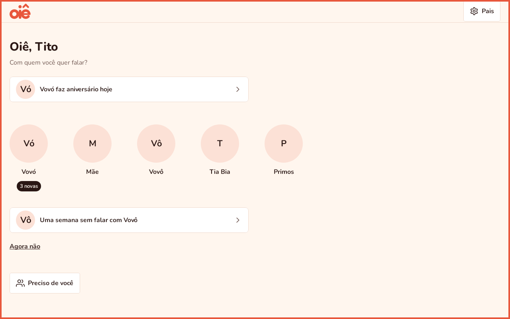
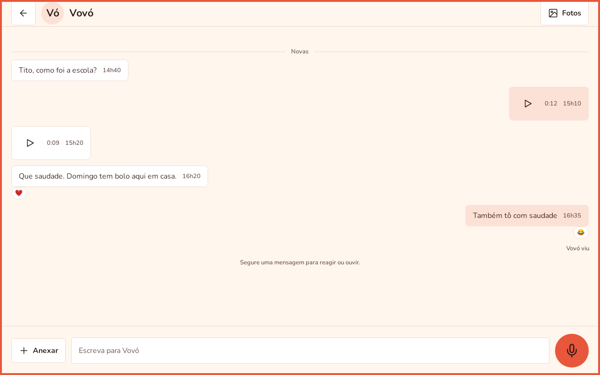
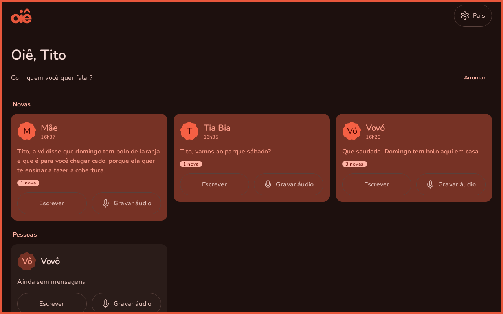
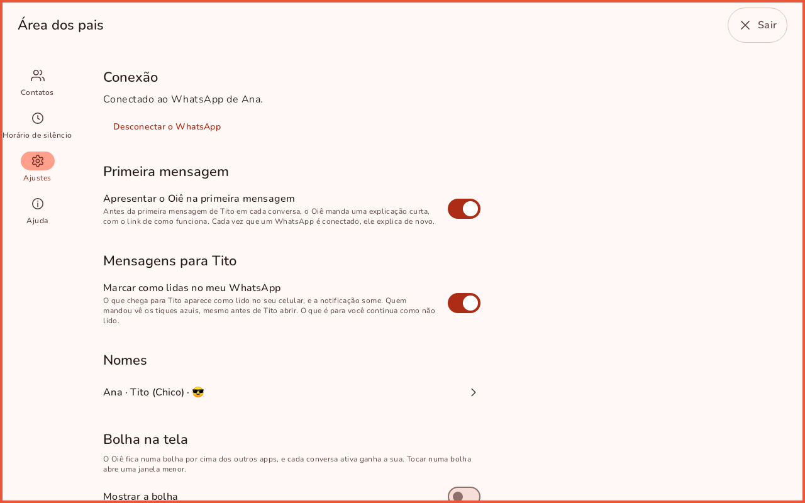

<p align="center">
  
</p>

<h3 align="center">Send love home.</h3>

<p align="center">
  Your kid messages the family from a tablet, through your WhatsApp,<br>
  only with the people you chose. No phone of their own, no new account.
</p>

<p align="center">
  <a href="https://github.com/gabrielbr/oie-releases/releases/latest"><b>Download for Android</b></a>
  ·
  <a href="https://gabrielbr.github.io/oie-releases/">Website</a>
  ·
  <a href="https://gabrielbr.github.io/oie-releases/safety/">Safety guide</a>
  ·
  <a href="CHANGELOG.md">What's new</a>
</p>

<p align="center">
  
</p>

---

## Family, within reach

Grandma sends a voice message. Your kid, aged 9 to 12, hears it on the tablet and answers with a drawing. Grandma gets both on WhatsApp, from your number, signed **Tito**, just like any other message. Nobody installs anything new, and nobody needs a new account.

Oiê is for families that aren't ready to give a kid a phone, but want them close to the people they love. It works a bit like the home phone used to: everyone at home can use it, and you know who's on the other end.

## What your kid can do

| | What it means |
|---|---|
| **Talk their way** | Text, voice messages (they can listen before sending), photos, videos, GIFs and stickers. |
| **Draw and play** | Draw a picture and send it, make a sticker from a photo, react to any message. |
| **Stay close** | See who wrote, with a birthday reminder on the day. Family statuses are there too, if you turn them on. |
| **Find people fast** | One tap to write or record. The home is a list, photos or a mosaic, and the kid picks favourites. |
| **Ask for you** | "Preciso de você" sends a short call for help to the people you marked, even in quiet hours. |
| **Read with help** | Messages can be read aloud, and photos zoom with two fingers. |

<p align="center">
  
  
</p>

## What you decide

- **Who.** Your kid only talks to the contacts and groups you allow. Nobody else can reach them. In a group you allowed, people who aren't on their list are marked "Fora dos contatos".
- **When.** Quiet hours for school and bedtime, or right now from your phone: send **/Tito silêncio** in WhatsApp, and **/Tito liberar** to lift it.
- **How it looks on your phone.** Messages for your kid are marked read, so your phone doesn't buzz for them. Messages for you stay unread.
- **Everything else** is in a parents' area on the tablet, behind your 6-digit PIN.

<p align="center">
  
</p>

## Private by design

- **Oiê has no servers.** The tablet links to your WhatsApp the way WhatsApp Web does. Messages travel only through WhatsApp.
- **Nothing reaches us.** Messages, photos and contacts stay on your family's devices. The app has no analytics, no ads, no tracking and no crash reporting.
- **One other connection.** The app checks GitHub's public page for updates, and installs one only when its fingerprint matches the release.

## The risk, plainly

Oiê uses your WhatsApp in a way WhatsApp doesn't officially offer. **WhatsApp may limit or block your number.** Oiê tells you this before you link, sends at a gentle pace and never sends in bulk, but the risk is real and it's yours to take.

No app makes a child completely safe, and Oiê doesn't replace your attention. It gives your kid a smaller, calmer place to talk to family. The [safety guide](https://gabrielbr.github.io/oie-releases/safety/) has what to talk about with them, and where to get help.

Oiê is not made, endorsed or supported by WhatsApp or Meta.

## Get started

1. **Install** the [latest release](https://github.com/gabrielbr/oie-releases/releases/latest) on the kid's Android tablet (Android 8 or newer). It updates itself after that.
2. **Read the risk, then link.** On your phone, open WhatsApp › Linked devices and scan the code on the tablet.
3. **Choose the people.** Pick the contacts and groups, give them the names your kid uses ("Vovó", "Tia Bia"), and set a PIN.
4. **Hand it over.** Oiê introduces itself the first time your kid writes to someone, so nobody is surprised.

In Brazilian Portuguese and English.

---

## For developers

This is the source of the Android app, the WhatsApp link and the website. Start with [PRODUCT.md](PRODUCT.md) (what it is and what it must never do), [STATUS.md](STATUS.md) (where things stand), and [AGENTS.md](AGENTS.md) (the rules every change follows).

| Part | Where | Built with |
|---|---|---|
| Android app (`app.oie`) | [`app/`](app/) | Kotlin, Jetpack Compose, Material 3 Expressive |
| WhatsApp link | [`link/`](link/) | Go and [whatsmeow](https://github.com/tulir/whatsmeow), built as an AAR ([docs/whatsapp-link.md](docs/whatsapp-link.md)) |
| Design tokens and colour scheme | [`design/`](design/README.md) | the Gabriel Design System core, Oiê's brand, Material's scheme from its coral |
| Website | [`site/`](site/) | static HTML and CSS, published to `oie-releases` |
| Decisions | [`00 Brief/decisions/`](00%20Brief/decisions/) | one file per decision, dated |

### Build and check

You need JDK 17 or newer and the Android SDK (platform 37.1). For the link, you also need Go and NDK r27c.

```sh
link/build-aar.sh                  # build the WhatsApp link once (link/oielink.aar)
python3 design/build.py --check    # tokens
python3 design/m3/scheme.py --check  # Material colour scheme and its contrast
./gradlew testDebugUnitTest        # the message rule, quiet hours, PIN, and more
./gradlew verifyRoborazziDebug     # screenshots of every screen: tablet and phone, light and dark, large text
./gradlew assembleDebug            # app/build/outputs/apk/debug/
```

Screenshots live in [`app/src/test/screenshots/`](app/src/test/screenshots/). A screen change re-records them on purpose with `./gradlew recordRoborazziDebug`.

### How changes go in

Every change, however small, goes through the same steps:
- the flow is written in [`docs/flows/`](docs/flows/);
- it's built with tests;
- it's audited with the four design skills in [`.claude/skills/`](.claude/skills/), with the audit saved in [`audits/`](audits/);
- its docs are updated;
- it's released as described in [docs/release.md](docs/release.md).

How many times each release was downloaded, from GitHub's public counts (`--mine 1` leaves out your own download of each):

```sh
scripts/downloads.sh
```

<p align="center"><sub>Oiê, said "oy-YEH".</sub></p>
