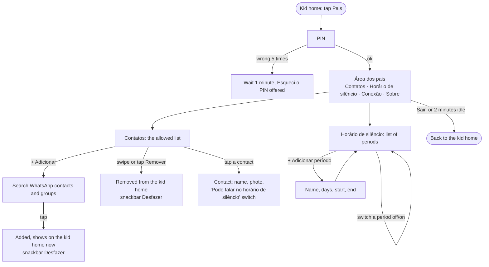

# Flow: Choose contacts + quiet hours

_Stage 5. Designed with `ux-user-flows` on 2026-11-18. The owner decided per-contact exceptions to quiet hours (2026-11-18). Defaults marked **(proposed)** are Claude's, for the owner to confirm._

- **Actor and job story:** the parent, in the parent area on the kid's tablet. *When my kid's circle changes (a new cousin, a grandparent's new number) or the routine changes (school term, holidays), I want to change who they can talk to and when, in a minute, so I can keep the circle right without supervising every message.*
- **Success measure:**
  - adding or removing a contact takes 3 taps after the PIN, under 30 s;
  - a quiet-hours change takes under 1 minute;
  - no kid ever reaches a contact that isn't on the list (product law, tested).
- **Entry points:**
  1. Setup steps 5–6 (flow "Parent setup + link").
  2. **Área dos pais**: a small "Pais" button in the corner of the kid's home, then the PIN.
  3. **A request from the kid (proposed):** the kid taps "Pedir para adicionar alguém" on the empty home, and the parent sees "{criança} pediu para adicionar alguém" in the parent area. No free text, so no way to reach a stranger.
- **Preconditions:** setup done; the WhatsApp link is connected for loading contacts. Without it, the saved list still shows.
- **Taps on the common path:** add a contact: Pais › PIN › Contatos › + › search › tap the name. That's 3 taps after the PIN, plus typing a few letters.

## Steps
| # | Screen | What the parent does | What the system does |
|---|---|---|---|
| 1 | **Kid home › Pais** | Taps the small "Pais" button (48dp, a corner, muted, not coral) | Opens the PIN pad. The kid can see the button, but the PIN keeps the area shut. |
| 2 | **PIN** | Types 6 digits | Wrong PIN: "PIN errado" and the dots shake (or appear without motion if animations are off). After 5 wrong tries, a 1-minute wait (owner, 2026-11-18), with **Esqueci o PIN** offered. |
| 3 | **Área dos pais** | Picks a section | Four rows: **Contatos** ("3 pessoas, 1 grupo"), **Horário de silêncio** ("Escola · Dormir"), **Conexão** ("Conectado ao WhatsApp de {perfil}"), **Sobre** (version, Check for updates, Ajuda). The area closes after 2 minutes idle (owner, 2026-11-18). |
| 4 | **Contatos** | Sees the allowed people and groups with photos | Lists them in the order the kid sees them. **+ Adicionar** is the one coral action. |
| 5 | **Adicionar** | Searches by name, taps one or more | Searches the parent's WhatsApp contacts and groups. Those already allowed show a check. A tap adds; a second tap removes. |
| 6 | **Remover** | Taps **Remover** on a row (a swipe also works) | Removes it at once with a **Desfazer** snackbar (5 s); no confirm. The conversation history stays on the tablet but is hidden from the kid. |
| 7 | **Contact detail** | Toggles **Pode falar no horário de silêncio** | The per-contact exception (owner's decision). Default off. |
| 8 | **Horário de silêncio** | Adds, edits or switches periods off | Each period has a name (Escola, Dormir…), days and start and end times. Suggested names come first; times are prefilled (Escola 7h–12h on weekdays, Dormir 21h–7h every day; owner, 2026-11-18). A switch pauses a period (e.g. holidays) without deleting it. |
| 9 | **Sair** | Taps **Sair**, or leaves it | Back to the kid home; the changes are live already. |

## Branches
| At step | If | Then |
|---|---|---|
| 2 | Forgot PIN | Flow "Parent setup + link", Forgot PIN. |
| 5 | WhatsApp not connected | The saved list shows. Adding is off, with "Conecte de novo para adicionar pessoas" and **Conectar** (goes to Conexão). |
| 5 | No results | "Ninguém com esse nome nos seus contatos do WhatsApp." The search text is kept. |
| 5 | A group is picked | The kid sees the group's name and photo, and **every member of the group can see what the kid sends.** The line under each group in the search says so before the tap: "Todos do grupo veem as mensagens." |
| 6 | Desfazer | Puts the contact back where it was. |
| 6 | Removing the last contact | Allowed. The kid's home shows its empty state. No confirm (undo is there). |
| 7 | A message arrives from a contact during quiet hours (not an exception) | It's kept and shown to the kid when the period ends (flow "Kid receives messages"). |
| 8 | Periods overlap | Allowed; quiet means any period is on. The list shows "Escola e Dormir se sobrepõem às 7h" as a plain note. |
| 8 | End before start (21h–7h) | Read as overnight; the row says "até 7h do dia seguinte". |
| any | Back | Returns one level; nothing is lost (each change saves at once). |

## States per step
| Step | Empty | Loading | Error | Success | Offline |
|---|---|---|---|---|---|
| Contatos | "Ninguém ainda. Adicione quem {criança} pode chamar." with **+ Adicionar** | — | — | List | List works; adding off |
| Adicionar | Before typing: the parent's recent WhatsApp chats first | Loading contacts | "Não deu para carregar seus contatos. Tentar de novo" | Check on the picked ones | Off, with Conectar |
| Horário de silêncio | "Sem horário de silêncio. {criança} pode mandar mensagens a qualquer hora." **+ Adicionar período** | — | Invalid time is prevented by the time picker | List with switches | Works (all on the tablet) |

## Exits
- **Sair** or idle goes back to the kid home, with every change already saved.
- From **Conexão**: reconnect (flow "Parent setup + link").

## Remembers
- The last section opened in the parent area.
- Recent WhatsApp chats lead the add list.
- Paused periods keep their times.

## Notes
- **Product law:** the allowed list is the only list. Oiê never shows the kid anyone else, and incoming messages from anyone else are never shown to the kid. They stay in the parent's WhatsApp as usual.
- **Groups (owner, 2026-11-18):** allowed, with the warning that everyone in the group sees the kid's messages. A family group is a common real case.
- **Data:** the list and the periods live on the tablet only.

## v0.19: a name for the kid, and the number
_The owner asked (2026-11-19): "my parents are saved under their own names; for my kid they're Vovô and Vovó". And: show each contact's number in the parent area, to be sure the right person was added._

- **Job story:** *When I add my parents, who are saved in my WhatsApp as "Maria Silva", I want my kid to see "Vovó", so the list reads like our family. And I want to see their number, so I know I picked the right Maria.*
- **Who sees what:**
  - the kid sees only the name the parent chose, everywhere: home, chat, notifications;
  - the parent sees that name, the number, and the WhatsApp name when it's different.
- **Nothing changes in WhatsApp.** The name lives on the tablet only; the parent's phone keeps "Maria Silva".

### Entries
1. **Setup, contacts step.** Each picked person gets **Mudar nome** under their number (tapping the row picks or unpicks it, so renaming needs its own target).
2. **Contatos.** Tapping a person or group in the allowed list opens the name editor, like a quiet period opens its editor. A line under the title says so until the parent has opened a contact once; after that, Help ("Quem pode falar com…?") says it.
3. **Adicionar pelo número** already asks for the name: that name is the one the kid sees.

### Steps (Contatos)
| # | Screen | The parent | The system |
|---|---|---|---|
| 1 | Contatos | Sees each person: the name, then the number ("+55 11 98765-0001") and the WhatsApp name when it's different | Groups say "Grupo" instead of a number. |
| 2 | Same | Taps "Maria Silva" | Opens **Mudar nome**: "Maria Silva no WhatsApp" and the number, then the field "Nome que Tito vê" with the current name. |
| 3 | Editor | Types "Vovó", taps **Salvar** | Back to Contatos; the row reads "Vovó", then "+55 11 98765-0001", then "Maria Silva no WhatsApp". The kid's home shows Vovó at once. |
| 3b | Editor | Clears the field and taps Salvar | Goes back to the WhatsApp name. The help line says so before saving. |
| 3c | Editor | Taps **Cancelar** or system Back | Nothing changes. |
| 3d | Editor | Taps **Remover Vovó dos contatos** | Back to Contatos with "Vovó saiu da lista · Desfazer" for 5 s. (v0.19 audit: Remover moved here from each row, so a phone row has room for the number. Removing is rare; adding is still one tap.) |

### States
- **The number is known** (people from the list, and people added by number): shown, grouped for reading.
- **WhatsApp hides the number** (a contact WhatsApp only knows by a private id): "Número não disponível". The WhatsApp name is still there to check.
- **Group:** "Grupo", no number.
- **Not renamed:** only the number on the second line, nothing repeated.

### Search
- The search in setup and Contatos also finds a number ("98765"), and the WhatsApp name of a renamed contact.

### Branches and errors
- **Blank name:** never saved as blank; it falls back to the WhatsApp name.
- **WhatsApp changes the contact's name later:** the kid's name stays; the parent's line updates the next time the list loads.
- **Removed and added again:** comes back with the WhatsApp name (the undo within 5 s keeps the chosen name).

### Flow review (§13), v0.19
| # | Question | Result |
|---|---|---|
| 1 | Job | ✅ One actor (the parent), one job. |
| 3 | Happy path | ✅ Contatos: tap, type, Salvar. Adding stays one tap; renaming is never forced. |
| 4 | Branches | ✅ Blank, cancel, back, hidden number, group, renamed by WhatsApp. |
| 5 | States | ✅ Above. |
| 6 | Errors | ✅ Blank can't happen; the help says what blank does. |
| 7 | Control | ✅ Cancel and Back; clearing goes back to the WhatsApp name. |
| 9 | Memory | ✅ The WhatsApp name and number are shown in the editor, so nothing has to be remembered. |
| 11 | Conventions | ✅ The same editor pattern as the quiet periods. |
| 13 | Accessibility | ✅ The row's click label says "Mudar o nome de Maria Silva"; Mudar nome is a 48dp target. |
| 14 | Ethics | ✅ The kid isn't misled about who it is: the parent picks a family name for a real family member; the number stays visible to the parent. |
| 15 | Evidence | 🟡 Does the parent find "tap to rename" in Contatos? The hint line is there; the owner's test will say. |

## v0.26: profile pictures
_The owner, 2026-11-19: "the contacts don't bring all their information, for example the profile picture."_

- **What:** each allowed person or group shows their WhatsApp profile picture instead of the letter circle:
  - on the kid's home (the big faces);
  - in the chat's header;
  - in Contatos and setup.
- **Whose:** only contacts the parent allowed. Oiê never looks up anyone else's picture.
- **No picture:** when a contact has none, or hides it from the parent's number (WhatsApp's own privacy setting), the letter circle stays. Nothing says why: it's their choice.
- **When:**
  - the picture is checked when the link connects and when someone is added;
  - each contact at most once a day, one at a time;
  - it asks only "did it change?", using WhatsApp's picture id, so an unchanged picture isn't downloaded again.
- **What's kept:** the small preview size (the one WhatsApp uses in chat lists), sealed on the tablet like photos (AES-GCM, Android Keystore). A removed contact's picture is deleted the next time pictures are checked.
- **Product law:** pictures come from WhatsApp's own servers to the tablet, through the parent's link; nothing goes to Oiê's servers (there are none).

| State | Shows |
|---|---|
| Picture known | The picture, round, the same size as the circle |
| None, hidden, or not loaded yet | The letter circle, as before |
| The contact changes their picture | The new one, within a day |

## Flow review (ux-user-flows §13)
| # | Question | Result |
|---|---|---|
| 1 | Job | ✅ One actor, one job, measured by time and the product-law test. |
| 2 | Entries | ✅ Setup, the Pais button, the kid's request (proposed). |
| 3 | Happy path | ✅ Add is 3 taps after the PIN. |
| 4 | Branches | ✅ Above. |
| 5 | States | ✅ Above. |
| 6 | Errors | ✅ Prevented by the time picker and the group warning before the tap; search text kept. |
| 7 | Control | ✅ Undo for removing, no confirms; back keeps everything. |
| 8 | Progress and resume | ✅ Each change saves at once; nothing multi-step to resume. |
| 9 | Memory | ✅ Recent chats lead the search. |
| 10 | Exits | ✅ Back to the kid home. |
| 11 | Conventions | ✅ Android time pickers and switches; swipe to remove has a button too. |
| 12 | Speed | ✅ Local; contact loading shows progress. |
| 13 | Accessibility | ✅ Swipe has a button alternative (2.5.7); switches have labels; the PIN pad is 48dp keys. |
| 14 | Ethics | ✅ The group warning is said before adding. The kid can see the Pais button exists: there's no hidden surveillance. |
| 15 | Evidence | 🟡 Test: do parents understand the group warning and the per-contact exception? |

**Issues**
- **Important:** the per-contact exception sits inside each contact's detail, so it's easy to miss. Fix: in Horário de silêncio, add a row "Podem falar mesmo assim: Mãe, Vovó" that opens the list of switches.
- **Polish:** the 5-try PIN wait (proposed) needs owner confirmation.

## v0.34: the design pass
- **Quem pode falar no silêncio:** the switch and its line show only when a quiet period is on (with none, a column of "off" switches read as "blocked").
- **Undo** (a removed contact, a deleted period, a deleted problem report) is one snackbar pinned to the bottom of the parent area, announced by TalkBack.
- **The period editor:** Back closes it (it left the parent area and lost the period); the days wrap on a phone and are checkboxes for TalkBack; **Apagar período** sits apart from Salvar.
- **The 2-minute timer** restarts on any touch or scroll, and on typing in any field.
- **Phone:** the four sections are a 2 x 2 grid (Contatos, Silêncio, Conexão, Ajustes), all in view.
- **Settings switches** (bubble, reminder, "Preciso de você") are whole-row switches. The bubble's row says "Ligada. Falta o Android permitir" until Android allows it.
- **Desconectar o WhatsApp** wears the stop colour, with **Cancelar** beside it.

## v0.42: groups in the add list, and "Conversa só de {kid}"
- **The fix:** groups had vanished from the "Adicionar" list (people only). The link asked WhatsApp for the groups on every contacts reload; when WhatsApp refused one of those asks, the groups were silently left out. Now the last good list of groups is kept and reused for 10 minutes, or until WhatsApp says a group was joined, left or renamed. A refusal is written to the problem report (the reason only, never a name). `link.go`: `groupCache`, tested.
- **New (the owner, 2026-11-21):** "flag specific contacts that it will be specifically for the kids, so it doesn't need to stay monitoring for keywords or to close after 24 hours." In the contact's editor, the switch **"Conversa só de {kid}"**, for people and groups (the owner chose one switch for both; it is the old "show the whole group" setting, now with a place to turn it on).
  - **On:** everything in that chat reaches the kid. No name needed, no 24-hour window, and no "talks about the kid" filter.
  - **Contatos says it** under the contact, in ink: "Tudo chega para {kid}".
  - **Never on the line to the parent:** the parent's own notes there stay private. The switch isn't shown there, and the rule ignores it.
  - **What the parent writes from their phone** in that chat still stays in the parent's WhatsApp.
