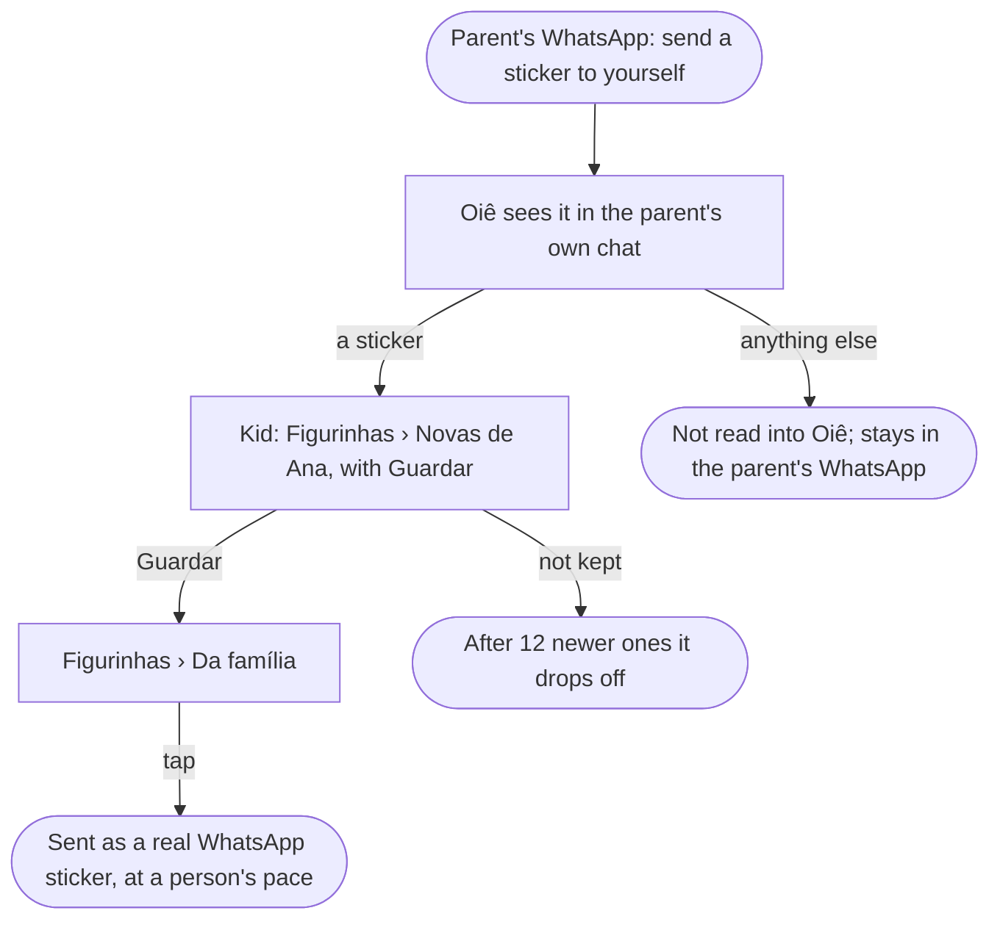

# Flow: Family stickers for the kid

_Designed with `ux-user-flows` on 2026-11-19, from the owner's request: "if I send stickers to myself in my WhatsApp, the kid can save them" (v0.10)._

- **Actors and job stories:**
  - *Parent:* when I see a sticker I like, I want to pass it to my kid without a new app or menu, so the kid has the family's stickers too.
  - *Kid:* when a new sticker arrives, I want to choose whether to keep it.
- **Success measure:**
  - sending a sticker to the kid takes the parent the same taps as forwarding it in WhatsApp;
  - keeping it takes the kid one tap.
- **Precondition:** the kid's side is on the real WhatsApp (v0.8).

## Steps
| # | Who | Does | System |
|---|---|---|---|
| 1 | Parent | Sends a sticker to their own chat in WhatsApp ("Message yourself") | Oiê downloads only that sticker and seals it on the tablet. |
| 2 | Kid | Opens Figurinhas | "Novas de {parent}" shows the new ones, each with **Guardar**. |
| 3 | Kid | Taps Guardar | It moves to "Da família", next to Oiê's six. |
| 4 | Kid | Taps a family sticker | It goes to the open chat as a real WhatsApp sticker, under the same pace and retry rules as every message. |

## Branches
| At step | If | Then |
|---|---|---|
| 1 | The parent sends text, a photo or anything else to their own chat | Nothing is read into Oiê (product law: the parent's own messages never reach the tablet). |
| 1 | The same sticker is sent twice | It's offered once. |
| 2 | More than 12 new ones are waiting | The oldest unsaved drop off and their files are deleted. Saved ones stay. |
| 1 | The kid's side is still on the sample | Nothing happens; the help says it works once the real WhatsApp is on. |

## Notes
- **Discoverability:** Ajustes e ajuda has the question "Como mando figurinhas para {kid}?".
- **Privacy:** of the parent's own chat, only sticker files are kept. They're sealed like photos.

## Flow review (ux-user-flows §13)
| # | Question | Result |
|---|---|---|
| 1 | Job | ✅ Two actors, each one action. |
| 3 | Happy path | ✅ Parent: a normal WhatsApp send. Kid: one tap to keep, one to send. |
| 4 | Branches | ✅ Other content, duplicates, too many, sample mode. |
| 7 | Control | ✅ The kid chooses what to keep. |
| 13 | Accessibility | ✅ Tiles have labels; Guardar is a 48dp text button. |
| 14 | Ethics | ✅ Nothing from the parent's own notes but stickers. |
| 15 | Evidence | 🟡 Does the parent find the help? Watch in the first family test. |
