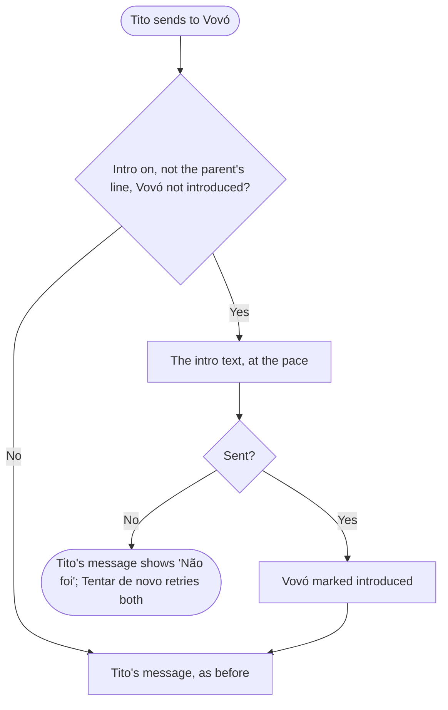

# Flow: The first message in a chat introduces Oiê (v0.47)

_Designed with `ux-user-flows` on 2026-11-21, at the owner's request: "when the kids message the first time in an individual chat or in a group, the Oiê app should send a message automatically before the kid's message … saying that the kid is using the parent's phone via one app, and a link to the app … very shortly … explain a little bit how this works. Approve the messaging with me before implementing."_

- **Actor and job story:** a grandparent, a friend or a group, getting the kid's first message from the parent's number. *When a message from my friend's mum's number says "Tito: oi", I want to know at once what this is and how to answer Tito, so I don't answer the mum by mistake or wonder if it's a scam.*
- **Success measure:** the receiver answers the kid, not the parent, the first time, and knows to start with the name later.

## The approved words (the owner, 2026-11-21)
| Chat | Portuguese | English |
|---|---|---|
| A person | Oiê · Tito está escrevendo pelo WhatsApp de Ana, com o app Oiê, no tablet. Responda aqui mesmo. Para puxar conversa com Tito depois, comece a mensagem com “Tito”. Como funciona: (link to `falar-com-a-crianca/`) | Oiê · Tito is writing from Ana's WhatsApp, with the Oiê app, on the tablet. Just reply here. To start a chat with Tito later, begin your message with “Tito”. How it works: (link to `talk-to-a-child/`) |
| A group | Oiê · Tito vai participar deste grupo pelo WhatsApp de Ana, com o app Oiê, no tablet. Tito vê tudo o que o grupo fala. Como funciona: (link) | Oiê · Tito will take part in this group from Ana's WhatsApp, with the Oiê app, on the tablet. Tito sees everything the group says. How it works: (link) |

The tablet's language picks the version. The names are the kid's and the parent's from Ajustes › Nomes.

## Rules
- **When:** before the kid's next message in every chat that hasn't had it, once per chat, ever. The owner chose "every chat, once", so chats where the kid already wrote before this update get it too.
- **Never:** on the line to the parent (their own chat), or when the parent turns it off.
- **The switch:** Ajustes › Primeira mensagem › "Apresentar o Oiê na primeira mensagem". It's on by default (the owner's choice).
- **Pace:** it's a send like any other: 4 s before the kid's message, counted in the 20 per 10 minutes (rule L3).
- **If it fails:** the kid's message isn't sent either (nothing goes out unexplained). The kid sees "Não foi" and "Tentar de novo", which retries both.
- **The echo:** its id is the tablet's own, and it starts with "Oiê ·", so it never shows on the tablet, and never as the parent's message in a group.

## Flow review (ux-user-flows §13)
| # | Question | Answer |
|---|---|---|
| 1 | Job | ✅ The receiver understands the first message and answers the kid. |
| 4 | Branches | ✅ Parent's line, switch off, already introduced, failure, echo. |
| 6 | Errors | ✅ A failed intro holds the kid's message, so nothing goes out half-explained. |
| 7 | Control | ✅ One switch in Ajustes. |
| 14 | Ethics | ✅ It says plainly who is writing and how. No claims, no tracking parameters in the link. One message per chat, ever, at a human pace, never bulk. |
| 15 | Evidence | 🟡 One real first message to a grandparent and one to a group. |

## v0.54: again for every new WhatsApp link
_The owner, 2026-11-22: "If the father decides that the mother will be the bridge, so they disconnect and connect again, the first message when they send to anyone should again send the first automated text … it must happen for every new WhatsApp connection."_

- **Before:** "once per chat, ever". After a switch to the other parent's WhatsApp, nobody heard from Oiê again, although the kid's messages now come from a number they've never seen used this way.
- **Now:** "once per chat, per WhatsApp link". The list of chats already introduced belongs to the WhatsApp that sent the intros, and starts empty when:
  - the tablet pairs with a WhatsApp (the QR code is read): after the parent disconnects Oiê and links again, with the same WhatsApp or another one; after WhatsApp logged the tablet out; after a PIN remake;
  - the tablet finds itself on a different WhatsApp than the one that sent the intros (`Intro.accountChanged`, checked before every first message).
- **The words:** unchanged, with the parent's name as set in Ajustes › Nomes. When the bridge changes, the parent changes the name there.
- **Unchanged:** never on the line to the parent, the switch in Ajustes, the pace, and what happens if it fails.

**Review (§13):**
- **Ethics ✅:** whoever's number the kid writes from, the people on the other side are told how it works.
- **Branches ✅:** same WhatsApp relinked, another WhatsApp, a PIN remake.
- **Evidence 🟡:** switch the bridge on the tablet and send to one grandparent.

