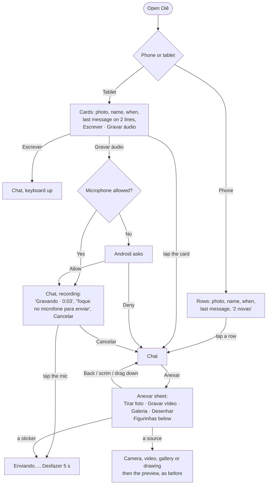

# Flow: The kid's home and Anexar (v0.38)

_Designed with `ux-user-flows` on 2026-11-20. The owner asked for it on 2026-11-20:_
- _the home lists people the way a chat app does, each with a short line about the last message;_
- _on the tablet, people show as cards with actions: Escrever and Gravar áudio;_
- _the chat's "Foto" button becomes "Anexar", with the stickers inside it._

- **Actor and job story:** a kid aged 9–12 on the family's tablet (or, sometimes, a phone). *When I open Oiê, I want to see at a glance who wrote to me and what we last said, and start a message or a voice message in one tap, so I can answer the people I miss without hunting.*
- **Success measure:** a voice message from the home in **1 tap + 1 tap** on the tablet (Gravar áudio, then the mic to send), down from tap, hold, release. Picking up a chat needs no opening of it just to see what was said.
- **Entry points:**
  - opening Oiê (the home);
  - Back from any chat;
  - a notification still opens the chat directly (flow "Kid receives messages"); the home is unchanged by it.
- **Preconditions:** the parent allowed at least one person (else the empty home, unchanged).
- **Taps on the common path:**
  - voice message (tablet): before **tap the person, hold, release**; after **Gravar áudio, tap the mic**;
  - text (tablet): before **tap the person, tap the field, type, Enviar**; after **Escrever, type, Enviar** (the keyboard is already up);
  - sticker: before **Figurinha, tap a sticker**; after **Anexar, tap a sticker** (the same two taps).

## Steps
| # | Screen / step | What the kid does | What the system does |
|---|---|---|---|
| 1 | **Home, phone** | Reads the rows; taps one | One row per person, in the parent's order (v0.34: places don't move). Each row: the 48dp photo, the name, when the last message came ("16h35", "Ontem", "Domingo", "08/11"), the last message on one line, and "2 novas" when there are unread ones. An unread row's message is bold and in ink. |
| 1t | **Home, tablet** | Reads the cards; taps one, or an action | Cards in even columns (3 across in landscape, 2 standing). Each card: the photo, the name (title), when, the last message on up to two lines, and two quiet buttons, **Escrever** and **Gravar áudio**. A card with unread messages has "3 novas" and its message in bold. |
| 2 | **What the last message says** | — | Text: the text (one line, new lines joined). The kid's own: "Você: …". Voice: "Áudio · 1:12". Photo: "Foto", or "Foto · its words". Video, GIF, Figurinha, "Mensagem apagada", and "Algo que só abre no WhatsApp" for the rest. Reactions never count as the last message. A message that didn't go: "Não foi · Você: …" in the error colour. No messages yet: "Ainda sem mensagens". |
| 3a | **Escrever** | Taps it | Opens the chat with the field focused, so the keyboard comes up (like a chat's bubble, v0.29). |
| 3b | **Gravar áudio** | Taps it | Opens the chat already recording: the clock runs, "Toque no microfone para enviar" says what to do, **Cancelar** throws it away. A tap on the mic sends it, then the usual 5 s **Desfazer**. Coming back to the chat later doesn't record again. |
| 4 | **Anexar** (chat) | Taps **Anexar** | One sheet: **Tirar foto**, **Gravar vídeo**, **Galeria** (the last used first), **Desenhar**; then **Figurinhas**: Oiê's set, the family ones kept, new ones from the parent to keep, and **Criar figurinha**. A sticker goes with one tap (5 s Desfazer). The sheet scrolls when it's taller than the screen. |

## Branches
| At step | If | Then |
|---|---|---|
| 1t | Quiet hours, or the link is down | The card's actions go (the chat's own controls are off then too); the card still opens the chat to read and listen. |
| 3b | The microphone isn't allowed | Android asks. Allowed: recording starts. Denied: the chat, not recording; the mic in the chat asks again (as before). |
| 3b | Recording can't start | "Não deu para gravar. Tente de novo." (as before). |
| 3b | Back during the recording | Back leaves the chat; the recording isn't sent (as before for a held recording). |
| 4 | Back, a tap on the scrim, a drag down | The sheet closes; nothing is sent. |
| 4 | The kid types (phone) | Anexar steps aside so the field has room, and comes back when the field is empty (decision 0010). |

## States per step
| Step | Empty | Loading | Partial | Error | Success | Offline |
|---|---|---|---|---|---|---|
| Home | "Ainda não tem ninguém aqui…" (unchanged) | Photos as letters until they load | A person with no messages: "Ainda sem mensagens" | A message that didn't go: "Não foi · …" | Rows or cards | Banner as before; on the tablet the actions go while the link is down |
| Gravar áudio | — | — | — | "Não deu para gravar" | "Gravando · 0:03" then Enviando… | Not offered while the link is down |
| Anexar | Only Oiê's stickers when no family ones | — | — | The photo errors as before | Sticker or preview | Anexar isn't shown when the kid can't send (as before) |

## Exits
- From a row or card: the chat. Back from the chat: the home.
- From Gravar áudio: the chat, with the voice message under Desfazer, or nothing if cancelled.
- From Anexar: the chat (sticker sent, or a preview to send).

## Remembers
- The parent's order of people (unchanged).
- The last photo source used comes first in Anexar (unchanged).
- A draft stays in the chat and isn't shown on the home (the home shows what was said, not what's being typed).

## Decisions taken here
- **Order:** the parent's order stays, not most recent first. A chat app sorts by time; v0.34 chose places that never move so a 9-year-old finds Vovó in the same spot every day. Unread is shown by the bold line and the "novas" pill.
- **Actions only on the tablet.** A phone row is one tap to the chat, as in chat apps; two buttons per row would crowd 360dp.
- **The Anexar icon is the plus** from the line set. There is no paperclip in the set; adding one is a core change (Gabriel Design System) and the word "Anexar" carries the meaning on the tablet.

## Flow review (ux-user-flows §13)
| # | Question | Answer |
|---|---|---|
| 1 | Job | ✅ One actor (the kid), one job story, a measurable tap count. |
| 2 | Entries | ✅ Open, Back, notification (unchanged, goes to the chat). |
| 3 | Happy path | ✅ Shorter: voice 2 taps instead of tap + hold; text with the keyboard up. |
| 4 | Branches | ✅ Quiet hours, link down, mic denied, recording fails, Back, scrim. |
| 5 | States | ✅ Empty, no messages, failed, unread, offline. |
| 6 | Errors | ✅ "Não foi" said in words on the home too, the same as the chat. |
| 7 | Control | ✅ Cancelar while recording; Desfazer 5 s after sending; sheet closes four ways. |
| 8 | Progress | ✅ The recording clock. |
| 9 | Memory | ✅ The last message is on the home: nothing to remember between chats. |
| 10 | Exits | ✅ No dead ends. |
| 11 | Conventions | ✅ A chat list on the phone (Jakob's law); attach as one sheet. Order kept steady on purpose (above). |
| 12 | Speed | ✅ All local; nothing waits. |
| 13 | Accessibility | ✅ Each row and card is one TalkBack stop that says name, "3 novas", the last message and when; the card's buttons say whom they're for ("Escrever para Vovó"); recording by tap needs no hold (WCAG 2.5.7), now for everyone. |
| 14 | Ethics | ✅ No nagging; unread is shown, never pushed. |
| 15 | Evidence | 🟡 To try with the kid: does Gravar áudio's tap-to-send feel natural next to the chat's hold-to-record? If it confuses, the chat's mic can accept both (it already does for TalkBack). |

Issues: none critical or important. Polish: the phone's unread line ellipsizes before the "novas" pill on long messages (accepted; the chat shows the rest).

## v0.42: Arrumar (the kid's own order, favorites on top)
_The owner, 2026-11-21: "allow the kid to reorganize the listing of the contacts that they have and also mark as favorites so they stay on top." The owner chose an "Arrumar" mode and the kid's order on the home._

- **Where:** "Arrumar", a link beside "Com quem você quer falar?", once there are two people. In the mode, the question becomes the hint and the link says "Pronto".
- **In Arrumar,** each person has three 52dp buttons:
  - a **heart:** favorites stay on top, and "Favorito" is written under the name, so it never depends on the colour alone;
  - **up** and **down:** the way to move someone without dragging.

  The whole row also **drags** after a long press.
- **The groups:** favorites first, then everyone else. Moving never crosses between them: the heart decides the group, and the arrows or dragging decide the order inside it. At a group's edge, the arrow is dimmed and says it's off.
- **On the home,** a favorite's row or card shows the heart beside the name, and TalkBack says "Favorito".
- **New people** the parent adds go to the end, in the parent's order. Pausing someone hides them; resuming brings them back to their place.
- **The parent's order in Contatos** doesn't change. The kid's order is saved on the tablet only.

| # | The kid | The home |
|---|---|---|
| 1 | Taps Arrumar | The list shows hearts and arrows. Birthdays, Novidades and the nudge step aside. |
| 2 | Taps Vovô's heart | Vovô moves to the top, with "Favorito" under the name. |
| 3 | Holds Lucas and drags him up | Lucas swaps place as he passes each person (not above the favorites). |
| 4 | Taps Pronto | The home is back, in the new order. |

## v0.45: news comes first, in the brand coral
_The owner, 2026-11-21: "the cards on the main screen, when we have a notification, are very soft and don't bring attention to the kid. Those should move up from the list and also have a highlight card, using the red of the brand and the notification tag. As happens on WhatsApp, when somebody contacts you, they go up."_

- **Order:**
  - Whoever has unread messages comes first, the newest message first (`HomeOrder.withNews`).
  - Everyone else keeps the kid's order (favorites, then Arrumar's order).
  - Once the kid opens the chat and reads, the person goes back to their place. The kid's order is never rewritten, so nothing the kid arranged is lost.
- **Look:**
  - A person with news wears a 2dp brand-coral edge (`news-edge`, 3.4:1 on the page, a graphic).
  - "3 novas" is filled with the brand coral, with ink on it (4.8:1).
  - Colour is never alone: the count is a word, and the last message is in bold.
- **Arrumar:** shows the kid's order only, with no news first, so arranging is never confused by moving rows.
- **The one-filled-coral rule:** each person with news has a coral tag. That's the owner's call (decision 0015). The filled coral action stays one per screen, because the home has no other.

| # | Situation | Before | After |
|---|---|---|---|
| 1 | Tia Bia (4th) writes "Tito, …" | Her card stays 4th, with a dark "1 nova" | Tia Bia moves to the top with a coral edge and "1 nova" |
| 2 | Vovó wrote 20 min earlier, still unread | Vovó 1st | Vovó 2nd (Tia Bia's is newer), also highlighted |
| 3 | Tito reads Tia Bia | — | Tia Bia goes back to 4th, plain |
| 4 | Arrumar | — | The kid's order, with no news first |

**Review (§13):** happy path unchanged (one tap to open). Accessibility: the label still reads the name, then "1 nova", then the message, and the order is the one read out. Evidence 🟡: Tito notices the new card on the tablet.

## v0.48: three views, and people apart from groups
_The owner, 2026-11-21: "Give the kid options to list the contacts as masonry, gallery, list. Separate groups from users."_

- **Sections:** the home shows **Pessoas**, then **Grupos**, each with its own title (a heading for TalkBack) when both exist.
  - The line to the parent counts as a person.
  - Inside each section: news first (v0.45), then favorites, then the kid's order.
  - In Arrumar, a move stays inside its section (`HomeOrder.move`, tested), and a new favorite goes to the end of its section's favorites.
- **Views**, picked in Arrumar under "Mostrar como" (a radio group of three words) and remembered on the tablet:

| View | What it shows | Good for |
|---|---|---|
| **Lista** | One row each: photo, name, time, the last message in one line, "N novas" | Many people, reading quickly. The default on a phone. |
| **Fotos** | A grid of big photos (or letters) with the name under them and "N novas". Nothing to read. | Younger kids; finding someone by face. |
| **Mosaico** | Cards in staggered columns, each as tall as its last message (up to 6 lines). On the tablet, with Escrever and Gravar áudio. | Seeing what each person said. The default on the tablet (today's cards). |

- **Why the choice lives in Arrumar:** it's rarely changed (less-is-more Q5), and Arrumar is already "how my home looks". The everyday home gains no controls.
- **Mosaico's reading order:** left to right, row by row, the same for TalkBack (`traversalIndex`), so news first still means first.
- **Taps:** opening a chat is still one tap in every view.

**Review (§13):**
- **Conventions ✅:** list, grid and mosaic are the common gallery choices.
- **Control ✅:** one tap changes the view back.
- **Memory ✅:** the choice is remembered.
- **Accessibility ✅:** radio semantics, 48dp targets, headings, reading order.
- **Evidence 🟡:** which view Tito picks.

## v0.50: "Novas" first, people and groups together
_The owner, 2026-11-21: "when a group has notification it stays very low. So before any of these groups we want a conditional group called Unread. Anything that has notification appears there in chronological order."_

- **Novas** (EN "Unread") is the home's first section. It holds everyone with unread messages, people and groups together, the newest message first, with the coral edge and "N novas" (v0.45). `HomeOrder.sections` is tested.
- **Pessoas** and **Grupos** follow with everyone else, in the kid's order.
- **When it shows:** only when something is unread. Once read, a person or group goes back to their own section and place. Titles show when more than one section has people.
- **Before:** news was first only within its own section, so a group with news still sat under every person.
- **Arrumar:** unchanged. Pessoas and Grupos, in the kid's order, with no Novas.

**Review (§13):**
- **Happy path ✅:** whatever needs Tito is at the top, one tap away.
- **Conventions ✅:** WhatsApp's "Unread" filter.
- **Accessibility ✅:** "Novas" is a heading, and each item's label says "N novas".
- **Evidence 🟡:** a group message reaches the top on the tablet.

## v0.51: the Lista view, fixed
_The owner, 2026-11-21: "List view of contacts seems broken … it does not take full width; time of last message is not aligned with end of line; there is no line separating each row, making it confusing."_

- **Full width:** the rows fill the column on the tablet too. Before, they were capped at 600dp and left half the screen empty beside them.
- **The time at the end:** the name and the heart share the start of the top line, and the time sits at the row's end, right above the "N novas" tag. Before, a short name pulled the time towards the middle.
- **A line between rows:** a 1dp `line` hairline separates plain rows. It starts where the text starts (after the photo) and ends where the time ends, as in WhatsApp and Contacts. Rows with news keep their coral edge and get 4dp of air instead of a line.
- **Unchanged:** Fotos and Mosaico, the row height (56dp min), the tap and long press.

**Review (§13):**
- **Memory ✅:** each row reads as one thing: photo, name, last message, time.
- **Conventions ✅:** the inset divider and end-aligned time of every messaging app.
- **Accessibility ✅:** the line is decoration; each row is still one labelled target.
- **Evidence 🟡:** Tito scans the list on the tablet without mixing rows.

