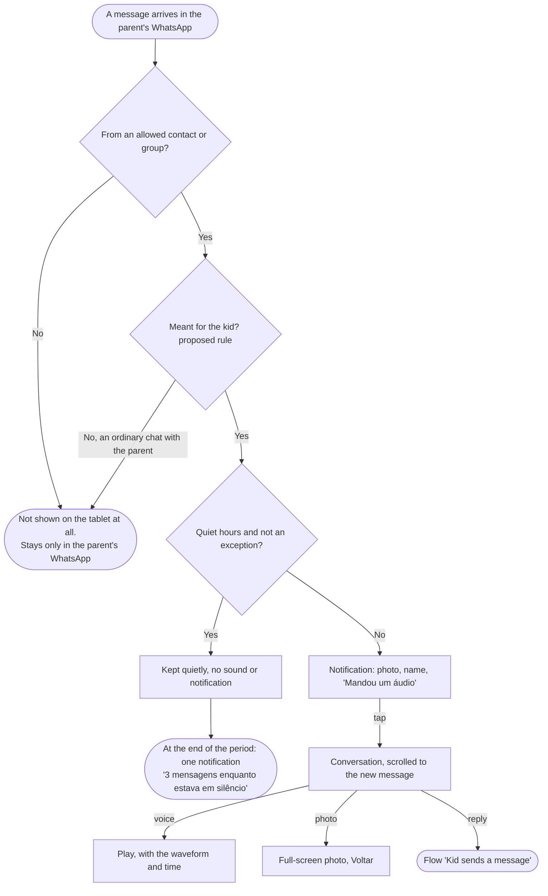

# Flow: Kid receives messages

_Stage 5. Designed with `ux-user-flows` on 2026-11-18. Defaults marked **(proposed)** are Claude's, for the owner to confirm._

- **Actor and job story:** the kid with the tablet. *When someone in my family answers me or sends me something, I want to know and see or hear it easily, so I can feel close and answer back.*
- **Success measure:**
  - the kid opens a new message within the day it arrives;
  - replying from a notification takes 2 taps.
- **Entry points:**
  1. A notification on the tablet, which opens the conversation.
  2. The kid home, where an unread mark sits on the photo.
  3. The conversation already open, where the message appears live.
- **Preconditions:** the link is connected; the sender is an allowed contact.
- **Taps on the common path:** tap the notification, then press play on a voice message. That's 2 taps.

## Which messages reach the kid (the key rule)
_Approved by the owner on 2026-11-18, **to be tested with 3 families' real chats before the build**._
The parent's WhatsApp carries all of the parent's own chats. The kid must see only the family talking **to the kid**:
- **In a 1:1 chat with an allowed contact:** the tablet shows only messages sent **after the kid's last message** in that chat, for a window of 24 h. It also shows any message that **replies to** (quotes) one of the kid's messages, at any time. The parent's own chats with grandma before and between stay private.
- **In an allowed group:** the same rule, by default. The parent can switch a group to **"Mostrar tudo do grupo"** in the contact detail, for a family group made for the kid.
- **A family member starting a new conversation with the kid:** they start the message with the kid's name ("Tito, …") or reply to the kid's last message. Oiê shows a message that starts with the kid's name.

### v0.21: a greeting first, and all the kid's names
_The owner, 2026-11-19: accept a short greeting before the name, and let the kid have as many names as the family uses ("Francisco, but also Tito, Chico, Fran")._
- **Greetings:** one short greeting may come before the name: "Oi Tito", "Oi, Tito", "Olá Chico", "Bom dia, Fran", "Boa tarde Tito", "Boa noite Tito", "E aí Tito", "Ei Tito", "Oie Tito", "Oiê Tito", "Alô Tito"; in English "Hi", "Hey", "Hello", "Good morning". Capitals and accents don't matter.
- **Still private:** the name in the middle of a sentence ("Fala pro Tito que…", "Oi, o Tito está aí?" counts only if the name comes right after the greeting, so this one doesn't), and a longer name that only starts the same ("Titozão").
- **Names:** the kid's name plus any nicknames, set in Ajustes › Nomes ("Apelidos": "Tito, Chico, Fran"). Any of them counts. The kid's messages are still signed with the main name ("Francisco: …").

This rule needs testing. The trade-off is privacy for the parent's own chats against missing a message meant for the kid. It's the riskiest assumption in v1.

## Steps
| # | Screen | What the kid does | What the system does |
|---|---|---|---|
| 1 | **Notification** | Sees it on the tablet | Shows the sender's photo and name, plus what kind of message it is ("Mandou um áudio", "Mandou uma foto") or the first line of text. Oiê's own sound. One notification per contact, grouped. |
| 2 | **Conversation** | Taps the notification or the photo on the home | Opens scrolled to the first unread message, with a "Novas" line above it. |
| 3a | **Voice message** | Taps play | Plays it, with the waveform and time; tap again to pause. Speed 1× only **(proposed)**. |
| 3b | **Photo** | Taps it | Full screen, then **Voltar**. Saving to the tablet's gallery is off **(proposed: the parent's photos stay in WhatsApp)**. |
| 3c | **Sticker / text** | Reads | Shown inline. Stickers from the family's WhatsApp are shown as received. |
| 4 | **Reply** | Uses the composer | Flow "Kid sends a message". |

## v0.40: talk about the kid, and the parent taking over, stay private
_The owner, 2026-11-21: "Phrases like 'o Tito já chegou?' are being sent to the tablet and shouldn't. We must have a more efficient way to detect when the message is for him."_

**Why it happened:** "o Tito já chegou?" doesn't start with his name and isn't a reply, but it came within 24 hours of Tito's last message, so the window let it in. The window can't tell a message **to** Tito from one **about** him, or one to the parent.

**Two new signals inside the window** (the owner chose both; the window stays 24 h):
1. **Talks about the kid.** One of the kid's names right after a word like *o, a, do, da, no, na, ao, pro, pra, pelo, com, para, sobre, de, sem, até* (or *is, with, for, about, tell, ask* in English) is talk about him: "o Tito já chegou?", "como está a Lia?", "manda beijo pro Tito". It stays private. Speaking to him still counts: "Tito, …", "Oi Tito", "Te amo, Tito", "Beijo Tito", "Boa noite, Ana e Tito".
2. **The parent took over.** When the parent writes in that chat from their phone after the kid's last message, the window closes: what the family says next answers the parent. It reopens when the kid writes again. Only the time the parent wrote is kept on the tablet, never what they wrote.

**Unchanged:** a reply to one of the kid's messages, or a message that starts with his name (after at most one greeting), always reaches him. Groups set to "Mostrar tudo do grupo" and the line to the parent work as before.

**Already on the tablet:** a stored message that talks about the kid leaves the chat (the same rule is applied when the chat is shown).

| # | In WhatsApp (Vovó's chat) | Before | Now |
|---|---|---|---|
| 1 | Tito: "Oi vó" | — | — |
| 2 | Vovó: "Oi meu amor" | Tablet | Tablet (window) |
| 3 | Vovó: "o Tito já chegou?" | Tablet | Private (talks about him) |
| 4 | The parent: "Chegou sim" | Private | Private, and the window closes |
| 5 | Vovó: "Que bom, beijos" | Tablet | Private (after the parent) |
| 6 | Vovó: "Tito, te amo" | Tablet | Tablet (his name first) |
| 7 | Tito: "Te amo vó", then Vovó: "❤️ dorme bem" | Tablet | Tablet (the kid wrote again) |

**Known limits:**
- "Tito chegou?" (his name first, no comma) still reaches him: in chats, people address kids that way, and starting with the name is how the family talks to him.
- "Diga ao Tito que eu amo ele" stays private now; the parent passes it on.

## v0.11: playing voice
A voice message plays on tap and stops on a second tap. Only one plays at a time. It plays from a temporary copy of the sealed file, deleted when it ends.

## v0.27: moving pictures (animated stickers, videos, GIFs)
_The owner, 2026-11-19: "animated stickers are not being animated", and "make sure the chat supports video attachments and animated GIFs."_

| Arrives | In the chat | Tap |
|---|---|---|
| **Animated sticker** | Moves in a loop, like in WhatsApp (in the chat and in the sticker sheet) | — |
| **GIF** (WhatsApp sends them as short silent videos) | Plays in a loop, silent, in the bubble, with a small "GIF" label | Opens it big |
| **Video** | Its first frame, a ▶ and the length ("0:42") | Opens a full-screen player with sound: ▶/❚❚, the time, and Back to return |
| **Video over 64 MB** | "Vídeo grande: só abre no WhatsApp de Ana" (not downloaded to the tablet) | — |

- **"Remove animations" (Android setting) is on:** stickers and GIFs stay still on their first frame; a GIF plays when tapped. Videos only play when tapped, always.
- **Notifications:** "Mandou um vídeo", "Mandou um GIF".
- **Storage:** videos and GIFs are sealed on the tablet like photos.
- **The message rule doesn't change:** a video counts like any other message (reply, name in the caption, 24 h).

## v0.31: WhatsApp's own animated stickers
_The owner's test (2026-11-20): animated stickers from WhatsApp's own packs showed still._

- **Why:** WhatsApp's store packs aren't animated WebP files. They're **Lottie** animations ("application/was", a small zip with an animation file), which Android can't draw by itself. Animated WebP stickers from other packs already moved (v0.27).
- **Now:** Lottie stickers move with Airbnb's Lottie library (Apache 2.0, decision 0008), in the chat and in the sticker sheet. When the kid saves one and sends it back, it goes out as the same animated sticker.
- **"Remove animations" on:** they stay on their first frame, like the others.
- **The report** says which kind a sticker was (animated WebP, Lottie, still), with no picture.

## Branches
| At step | If | Then |
|---|---|---|
| — | From someone not allowed | Never shown, never notified (product law). It stays in the parent's WhatsApp. |
| — | Quiet hours, sender not an exception | Kept without sound. One summary notification when the period ends. |
| — | Quiet hours, sender is an exception | Normal notification. |
| 3a | Media still downloading | "Baixando…" with progress; tap to retry if it fails: "Não abriu. Toque para tentar de novo." |
| 3 | A message type Oiê can't show (a document, a location, a poll) | "{Vovó} mandou algo que só abre no WhatsApp." No link to WhatsApp (the tablet doesn't have it). |
| — | A message is deleted for everyone in WhatsApp | Removed on the tablet too, with "Mensagem apagada". |
| — | The link drops | The conversation still shows what's on the tablet. New messages stop, and the home shows "Peça para {nome} conectar de novo". |

## States per step
| Step | Empty | Loading | Error | Success | Offline |
|---|---|---|---|---|---|
| Conversation | "Mande o primeiro oi para {Vovó}." | Skeleton under 1 s | Media failed: retry | New messages under "Novas" | What's on the tablet; "Sem internet" |
| Voice | — | "Baixando…" | Retry | Plays | Plays if already downloaded |

## Exits
- Reply (flow "Kid sends a message").
- Back to the home; the unread mark clears.

## Remembers
- Read and unread per message.
- The playback position of a long voice message.

## Notes
- **Data:** received messages are stored on the tablet only, encrypted at rest **(proposed)**, and nowhere else: Oiê has no servers.
- **Notifications:** Oiê's own channel, so the parent can silence it in Android's settings too.
- **Product law** is tested here: an automated test sends from an un-allowed number and checks that nothing appears.

## Flow review (ux-user-flows §13)
| # | Question | Result |
|---|---|---|
| 1 | Job | ✅ |
| 2 | Entries | ✅ Notification, home, live. |
| 3 | Happy path | ✅ 2 taps to hear a voice message. |
| 4 | Branches | ✅ Not allowed, quiet hours, exceptions, unsupported, deleted, offline, unlinked. |
| 5 | States | ✅ |
| 6 | Errors | ✅ Retry on media; plain words. |
| 7 | Control | ✅ Back everywhere. |
| 8 | Progress and resume | ✅ "Novas" line; playback position kept. |
| 9 | Memory | ✅ |
| 10 | Exits | ✅ |
| 11 | Conventions | ✅ Grouped notifications; tap to play. |
| 12 | Speed | ✅ |
| 13 | Accessibility | ✅ Notifications are read aloud by TalkBack with the type in words; the play button has a 48dp target and a state label. |
| 14 | Ethics | ✅ No read receipts pushed onto the kid **(proposed: the kid's reads are not reported back)**; no streaks. |
| 15 | Evidence | 🔴 **The rule for which messages reach the kid is untested and is the riskiest decision in v1.** Prototype it with real family chats before building. |

**Issues**
- **Critical (for the build, not for this doc):** the "meant for the kid" rule. If it's wrong, either the kid sees the parent's private chats or misses family messages. Fix: test it with 3 families' real chat patterns before Stage 7, and decide with the owner.
- **Important:** a family member may not know to start with the kid's name. Fix: the kid's messages arrive tagged "Tito: …", so replies naturally follow; and add a one-line tip in the website's "for family" section.

## v0.34: the design pass
- The conversation now really opens on the first unread message, under a "Novas" line, as step 2 says (it opened on the oldest).
- A video still downloading says "Vídeo de 0:42, chegando…", with no ▶ (nothing to play yet).
- Pictures, video frames and profile photos are opened off the main thread, so the chat scrolls smoothly.
- A tap on a photo opens it big (v0.33); a family member's reaction shows under the message.

## v0.42: conversations that are the kid's own
Rule 4 ("Mostrar tudo do grupo") is now for people too, and the parent turns it on in the contact's editor: **"Conversa só de {kid}"**. Everything in such a chat reaches the kid: no name check, no 24-hour window, and none of v0.40's filters. The line to the parent is never treated this way (`MessageRule`, tested). See `contacts-quiet-hours.md`, v0.42.
