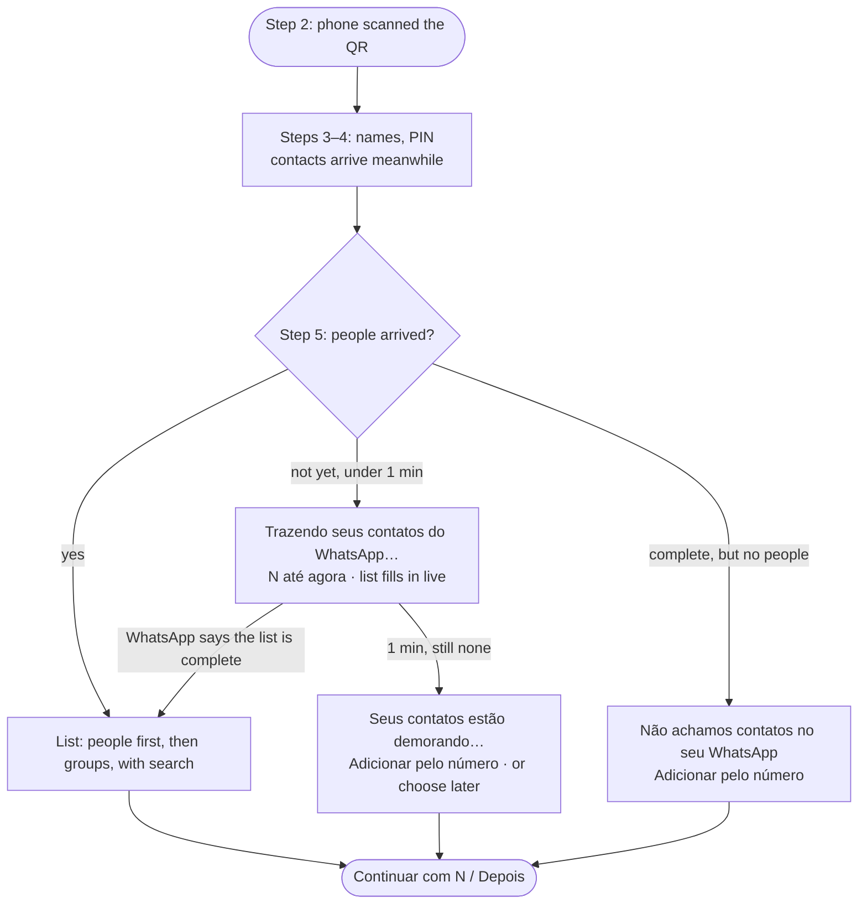

# Flow: Parent setup + link

_Stage 5. Designed with `ux-user-flows` on 2026-11-18. The owner decided on 2026-11-18:_
- _the parent area lives on the kid's tablet behind a 6-digit Oiê PIN, with no parent app and no server;_
- _setup asks for the kid's name, the parent's name, the first contacts and quiet hours._

- **Actor and job story:** a parent with the family's Android tablet and their own phone with WhatsApp. *When I want my kid to talk to the family without my phone, I want to set up Oiê on the tablet once, knowing the risk, so I can hand the tablet over and know they only reach the people I chose.*
- **Success measure:** setup finished in **under 5 minutes** by a parent on their own, with no help. Drop-off is measured at each step. The risk notice is never skipped.
- **Entry points:**
  1. First open of Oiê on the tablet, after installing it.
  2. Returning mid-setup: Oiê reopens at the step it stopped on.
  3. **Reconnect:** the link dropped, so the kid's side says "Peça para {nome} conectar de novo", and the parent opens the parent area to scan again.
  4. **Forgot PIN:** relinking WhatsApp proves it's the parent.
- **Preconditions:**
  - an Android tablet with internet;
  - the parent's phone with WhatsApp, nearby;
  - WhatsApp allows another linked device (WhatsApp limits how many a number can have).
- **Taps on the common path:** about 12 taps plus typing two names and a PIN. Linking is the slow part, about 30–60 s on the phone.

```mermaid
flowchart TD
  start([First open on the tablet]) --> welcome[Welcome, for the parent<br/>'Oiê é para seu filho ou filha conversar<br/>com a família pelo seu WhatsApp'<br/>Começar]
  welcome --> risk[Risk notice<br/>Entendi, conectar / Agora não]
  risk -- Agora não --> later([Closes. Next open: the welcome again])
  risk -- Entendi, conectar --> link[QR on the tablet + 4 steps for the phone]
  link --> linked{Scanned and linked?}
  linked -- QR expired --> link
  linked -- WhatsApp refused, too many devices --> tooMany[Remove a device in WhatsApp, then try again] --> link
  linked -- Yes --> names[Your name, prefilled from WhatsApp<br/>Your kid's name]
  names --> pin[Create a 6-digit PIN, twice]
  pin --> contacts[Choose who your kid can talk to<br/>at least 1, or Depois]
  contacts --> quiet[Quiet hours<br/>turn periods on, or leave them off]
  quiet --> done[Pronto. Entregue o tablet para {criança}]
  done --> kid([Kid side: the kid notice, then the home])
```

## Steps
"Passo x de 6" shows on steps 1–6.

| # | Screen | What the parent does | What the system does |
|---|---|---|---|
| 0 | **Welcome** | Reads one line, taps **Começar** | "Oiê é para seu filho ou filha conversar com a família pelo seu WhatsApp, só com quem você escolher." Shows the wordmark and one cluster of rounds. |
| 1 | **Risk notice** | Reads and taps **Entendi, conectar** or **Agora não** | Shows the approved copy (`01 Brand/voice.md`) in full, not folded and not in small print. **Entendi, conectar** is the one coral button. **Agora não** is a quiet button with the same reach. |
| 2 | **Link** | On the phone: WhatsApp › **Configurações** › **Dispositivos conectados** › **Conectar um dispositivo**, then scans the QR on the tablet | Shows a big QR code and the 4 steps, numbered, in the parent's words. The QR refreshes on its own before it expires. After the scan, "Conectando…" with progress. On success: "Conectado ao WhatsApp de {perfil}". |
| 3 | **Names** | Checks their own name (prefilled from the WhatsApp profile name) and types the kid's name | The kid's name tags messages ("Tito: …"). The parent's name is used in the kid notice. Both can be changed later in the parent area. |
| 4 | **PIN** | Types 6 digits, then again | "Esse PIN abre a área dos pais neste tablet. Não use o mesmo PIN do tablet." Rejects 000000, 123456 and the like, with a plain reason. |
| 5 | **First contacts** | Searches and picks family from their WhatsApp contacts and groups, then taps **Continuar** | Shows the parent's contacts with search. Picked ones go to the top with a check and `selected`. At least one keeps the kid's home from being empty; **Depois** is allowed (the kid's home then shows its empty state). Details in flow "Choose contacts + quiet hours". |
| 6 | **Quiet hours** | Turns the preset periods on (or leaves them off), or sets times (e.g. school 7h–12h, bed 21h–7h) and optional exceptions (contacts allowed even then) | Default: none. Exceptions per contact (the owner's decision, 2026-11-18). |
| 7 | **Done** | Hands the tablet over | "Pronto. Entregue o tablet para {criança}." One button: **Abrir para {criança}**. The kid side opens with the kid notice. |

## Branches
| At step | If | Then |
|---|---|---|
| 1 | **Agora não** | Oiê closes. Nothing is linked or stored. The next open starts at the welcome again. No nagging. |
| 2 | The QR expires | It refreshes on its own; nothing to tap. |
| 2 | The phone isn't near, or the parent leaves | The step is kept. Coming back reopens the QR. |
| 2 | WhatsApp refuses because of too many linked devices | "O WhatsApp já tem o máximo de aparelhos conectados. No celular, remova um em Dispositivos conectados e tente de novo." **Tentar de novo**. |
| 2 | WhatsApp refuses for another reason (e.g. the number is restricted) | "O WhatsApp não aceitou a conexão agora. Tente mais tarde." No tech words; the detail is kept for Ajuda. |
| 2 | Linking takes over 10 s | Progress with "Isso pode levar até 1 minuto" and **Cancelar**. |
| 2 | Tablet offline | "Sem internet. Conecte o tablet ao Wi-Fi para continuar." The QR is hidden until it's back. |
| 3 | Kid's name empty | **Continuar** stays off. The hint "Como a família chama seu filho ou filha?" is the label, above the field. |
| 4 | PINs don't match | "Os PINs não são iguais. Digite de novo." Only the second field clears. |
| 4 | An easy PIN | "Esse PIN é fácil de adivinhar. Escolha outro." |
| any | Back | Returns one step; everything typed is kept. From the link step on, back never unlinks. |
| any | The parent closes Oiê mid-setup | Reopens at the same step. The kid side isn't reachable until setup is done. |

## v0.17: bringing in the contacts
_Designed with `ux-user-flows` on 2026-11-19 from the owner's request: "after connecting, we allow the user to already add who the child can talk to. It currently only lists groups. Maybe after connecting we should have a sync view, or status, to grab all this info from WhatsApp."_

- **The problem:** WhatsApp sends the parent's contacts to a new linked device in a snapshot, seconds to a minute after linking. Groups come from a separate, immediate call. So the contacts step (step 5) could show only groups, with nothing saying more was coming. That failed heuristic 1 (visibility of system status).
- **The design:** the contacts list says what it's waiting for, and fills in live.



| State | When | What the parent sees |
|---|---|---|
| **Syncing** | Linked, WhatsApp hasn't said the contact list is complete, under 1 minute | A line with a small spinner, or no spinner when animations are off: "Trazendo seus contatos do WhatsApp… 128 até agora". The list below grows as they come. |
| **Ready** | People have arrived | The list, people first, then groups. The search shows when there are more than 12. |
| **Slow** | 1 minute, and still no people | "Seus contatos estão demorando para chegar. Adicione alguém pelo número, ou escolha depois em Contatos." The add-by-number form is right there. |
| **Empty** | WhatsApp said the list is complete, but it has no people | "Não achamos contatos no seu WhatsApp. Adicione alguém pelo número." |
| **Offline** | The link dropped | Nothing new: what has arrived stays; "Conectar de novo" is in Conexão. |

- **Same in the parent area:** Contatos uses the same line, replacing v0.13's "Carregando seus contatos…".
- **Signal:** the link reports "contacts complete" when WhatsApp's contact snapshot has been applied (`AppStateSyncComplete` for the contact list), or after its own one-time fetch. The 1-minute "slow" is only the fallback.
- **Control:** the parent never waits on a spinner. They can type a name in the search, add by number, or tap Depois at any moment.
- **Motion:** the spinner honours "Remove animations"; then it's just the words and the count.

## v0.9: changing the names
Both names from setup step 3 can be changed later in Parent area › **Ajustes e ajuda** (formerly "Ajuda e sobre"). A blank field keeps the last name. The kid's name drives the message rule ("Tito, …") and signs the kid's messages ("Tito: Oi, vó"), so a change takes effect at once for both.

## v0.8: the real link
- **Step 2:** "Conectar o WhatsApp" shows the QR and WhatsApp's own steps. When the phone scans it, the kid's side uses the real WhatsApp (`AppState.realMode`), and the contacts step lists the parent's real contacts, with a search when there are more than 12. (**Usar exemplo por enquanto** was removed in v0.12.)
- **Since v0.12 there is no sample.** Setup step 2 links the real WhatsApp, with no "use the sample" way out. A tablet updated from the sample drops its sample chats and contacts. Conexão then shows **Conectar o WhatsApp**, which shows the risk and the QR, and lands in Contatos when nobody is chosen yet. **Desconectar o WhatsApp** unlinks.
- **Contatos (v0.12):**
  - the parent's contacts arrive a few seconds after linking; the list reloads as they come and each time Contatos opens;
  - people come before groups, with a search;
  - **Adicionar pelo número** adds someone missing from the list, once WhatsApp confirms the number. Otherwise: "Esse número não está no WhatsApp."

## Reconnect and forgot PIN
- **Reconnect** (the link dropped). The kid's side says "Peça para {nome} conectar de novo." The parent opens **Área dos pais** with the PIN, sees "O Oiê se desconectou do seu WhatsApp", and taps **Conectar de novo**, which goes back to step 2. Messages the kid sent meanwhile are kept and go out after.
- **Forgot PIN (v0.34, fixed).** On the PIN screen: **Esqueci o PIN** opens **Fazer um PIN novo**. It explains, then **Mostrar o código**: the tablet leaves WhatsApp and shows a fresh QR. When the **same** WhatsApp scans it, the parent chooses a new PIN and lands in the parent area; the kid's contacts and chats stay. When **another** WhatsApp scans it, Oiê starts over from the names step (the old contacts belonged to the old account). Being able to link the same WhatsApp proves it's the parent.
  - Before v0.34 it went to setup step 2, which skipped ahead when WhatsApp was already linked: anyone holding the tablet could set a new PIN and pick contacts (the design audit's P0).
- **Unlink** (parent area): **Desconectar do WhatsApp** is destructive and can't be undone from the tablet. It is the one place with a confirm: "O {criança} não vai conseguir mandar nem receber mensagens até você conectar de novo." **Desconectar** (stop fill) / **Cancelar**.

## v0.20: "desconectado" on the tablet, "conectado" on the phone
_The owner's report (2026-11-19): the link works and the contacts arrive, but after a while the tablet says it's disconnected, while WhatsApp still shows the tablet as connected._

- **Cause:** every time Oiê comes back to the screen (or the tablet is turned), it asked the link to connect. When the connection was already up, WhatsApp's library answered "already connected", and Oiê took that for a failure: it showed "disconnected" over a working connection.
- **Now:**
  - Oiê first asks the link whether it's up. If it is, nothing changes, and "connected" never flickers to "connecting".
  - If the screen said "disconnected" but the link is up, it says "connected" again.
  - Only a link that is really down is reconnected.
  - A QR on screen is never restarted by coming back to the app or turning the tablet.
- **What WhatsApp's list means:** "Dispositivos conectados" on the phone lists every *linked* device, even one that's offline right now (for example a tablet asleep). The tablet's own status is the one that says whether messages are flowing now.
- **Still true:** when the tablet sleeps deeply, Android can pause the network; the link reconnects when the tablet wakes, the network returns, or Oiê opens. A drop and each reconnect go into the problem report, now with WhatsApp's "keep-alive" misses too, so a real drop can be told from a false one.

| State on the tablet | Link really | Before v0.20 | Now |
|---|---|---|---|
| Conectado | up | sometimes turned to "desconectado" on return | stays "conectado" |
| Desconectado | up | stayed wrong until a restart | turns "conectado" when Oiê opens |
| Conectado or desconectado | down | reconnected | reconnects ("conectando", then "conectado") |

## v0.24: "Conectando…" is not "desconectado"
_The owner's report (2026-11-19): after updating, Oiê says it needs to connect again, but it is connected._

- **Cause:** after an update (or any restart), Oiê takes a few seconds to reconnect by itself. Every screen read "not connected yet" as "disconnected":
  - Ajustes › Conexão said "O Oiê se desconectou do seu WhatsApp" and offered **Conectar o WhatsApp**;
  - the kid's home said "Peça para Ana conectar de novo".
  A short network drop that WhatsApp's library fixes on its own did the same.
- **Now, three states as the screens see them** (`LinkView`):

| Shown | When | Kid's home | Conversation | Conexão |
|---|---|---|---|---|
| **Conectado** | the link is up | nothing | can send | "Conectado ao WhatsApp de Ana." |
| **Conectando** | linked, not up yet, for less than 30 s (since Oiê opened, or since the drop) | nothing | can send: messages wait and go out on connect (L4) | "Conectando ao WhatsApp de Ana…", no button |
| **Desconectado** | still not up after 30 s, or never linked | "Peça para Ana conectar de novo" | "Peça para Ana conectar" | "O Oiê se desconectou…" with **Conectar o WhatsApp** |

- **Unchanged:** logged out, banned and unavailable keep their own screens. A real drop still shows, 30 seconds later. The problem report still records every change.

## States per step
| Step | Empty | Loading | Error | Success | Offline |
|---|---|---|---|---|---|
| Link | — | "Conectando…" with a cancellable wait | Refused / too many devices (above) | "Conectado ao WhatsApp de {perfil}" | QR hidden, Wi-Fi line |
| Names | Kid field empty → Continuar off | — | — | — | Works offline |
| Contacts | No contacts loaded yet → skeleton list | Loading contacts | "Não deu para carregar seus contatos. Tentar de novo" | Count shown: "3 escolhidos" | "Sem internet…" |
| Done | — | — | — | Kid side opens | Kid side opens; sends queue |

## Exits
- **Finished:** the kid side, with the kid notice first.
- **Agora não:** Oiê closes with nothing stored. Next open shows the welcome.
- **Mid-setup:** resumes at the same step.
- **Reconnect / forgot PIN:** back in the parent area.

## Remembers
- The step reached, and everything typed in setup.
- The parent's name, from the WhatsApp profile.
- The last quiet hours used (for the parent area later).

## Notes
- **Data:** the WhatsApp link, names, PIN (hashed) and settings live on the tablet only. Nothing goes to our servers.
- **Self-update** (the core rule) applies to the tablet app from the first release. The "Check for updates" row lives in the parent area's About.
- **Distribution:** Play may not accept the app, so it may ship as a direct APK (open item in STATUS). Setup starts after install either way.
- **Copy** follows `01 Brand/voice.md`. "Dispositivos conectados" and "Conectar um dispositivo" are WhatsApp's own menu names, used only to guide the parent there.

## Flow review (ux-user-flows §13)
| # | Question | Result |
|---|---|---|
| 1 | Job | ✅ One actor (the parent), one job story, success in time and drop-off. |
| 2 | Entries | ✅ First open, resume, reconnect, forgot PIN. |
| 3 | Happy path | 🟡 Six steps. Each asks for something needed now; quiet hours and contacts allow **Pular** / **Depois**. Could quiet hours move to the parent area to shorten it? Kept, by the owner's choice. |
| 4 | Branches | ✅ Agora não, QR expiry, too many devices, refused, slow, offline, back, close, mismatch, weak PIN. |
| 5 | States | ✅ Table above. |
| 6 | Errors | ✅ Plain words, input kept, a clear next step; the PIN clears only the second field. |
| 7 | Control | ✅ Back keeps input; the only confirm is unlinking, which is destructive. |
| 8 | Progress and resume | ✅ "Passo x de 6"; resumes at the same step. |
| 9 | Memory | ✅ The parent's name is prefilled; the phone steps stay on screen during linking. |
| 10 | Exits | ✅ Ends by handing over to the kid; nothing is a dead end. |
| 11 | Conventions | ✅ Linking by QR like WhatsApp Web; PIN entry like Android's. |
| 12 | Speed | ✅ Waits over 10 s show progress and Cancelar. |
| 13 | Accessibility | ✅ v0.34: labels, errors and waits are announced; every step works with TalkBack. Linking needs the phone's camera (QR); a phone-number code is on the roadmap as the owner's decision. |
| 14 | Ethics | ✅ The risk is said in full **before** linking, with an equal "Agora não"; no preselected options, no nagging after a no. |
| 15 | Evidence | 🟡 Test with 3–5 parents: do they understand the risk notice, and can they find "Dispositivos conectados" alone? |

**Issues**
- **For the owner (roadmap):** a linking alternative to the QR (WhatsApp's phone-number code). The link library has it (PairWithCode); it waits on the owner's choice.
- **Polish:** the 4 phone steps should follow the WhatsApp version on the parent's phone (menu names change). Keep them in one place in the code, easy to update.

## v0.34: the design pass
- **Welcome:** the brand's rounds and "A família ao alcance." (the name isn't retyped under the logo).
- **One title style** on every step, one left edge, and **Voltar** on steps 2 to 6.
- **Risk notice:** **Entendi, conectar** starts the link, so step 2 opens on the QR. **Agora não** closes Oiê and it opens on the welcome next time.
- **Step 2:** coming back when it's already linked shows "Conectado ao WhatsApp de Ana." with **Continuar** (it used to jump forward by itself). Waiting shows a spinner; a failed try says "Não deu para conectar…", no internet says "Sem internet no tablet…", each above **Conectar o WhatsApp**.
- **Step 3:** the parent's name comes from their WhatsApp profile when it's blank.
- **Step 4:** after "Os PINs não são iguais" it starts over from the first PIN.
- **Step 5:** picked rows are highlighted and checked for TalkBack; **Depois** shows only while nobody is picked, then **Continuar · N escolhidos**.
- **Step 6:** each period is one switch row; **Pular** went (it did what Continuar does).
- **Fields:** the label is read with the field, the border is visible (3:1), and errors are announced.
