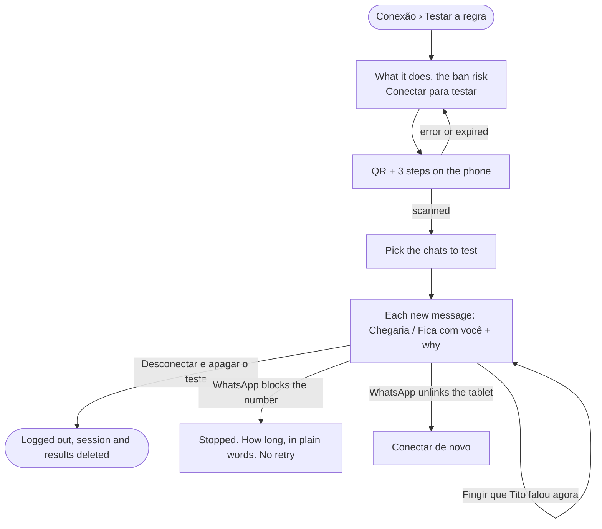

# Flow: Test the message rule with real chats

_Designed with `ux-user-flows` on 2026-11-19. It unlocks the riskiest decision in v1: which messages reach the kid (flow "Kid receives messages", decision 0001)._

- **Actor and job story:** the parent, in the parent area. *When I'm deciding whether Oiê is safe to use, I want to see which of my real WhatsApp messages would reach my kid, so I can trust that my own chats stay private and that family messages get through.*
- **Success measure:**
  - after a day or two, the parent can say whether the rule got it right for each picked chat;
  - no message from a chat they didn't pick is kept;
  - nothing is sent.
- **Entry:** Parent area › Conexão › **Testar a regra com seu WhatsApp**, behind the PIN.
- **Preconditions:**
  - the parent's phone with WhatsApp;
  - ideally a spare number (the screen says why);
  - the tablet is arm-based (nearly all are).
- **Taps on the common path:**
  - Conectar para testar, then scan with the phone;
  - pick a chat (type a few letters, tap it);
  - read the results as messages arrive.

## Steps
| # | Screen | What the parent does | What the system does |
|---|---|---|---|
| 1 | **Intro** | Reads, taps **Conectar para testar** | Says plainly: read-only, nothing sent, stays on this tablet. Says the ban risk and suggests a spare number. |
| 2 | **QR** | Scans it in WhatsApp › Dispositivos conectados | The link pairs read-only. In WhatsApp the tablet shows as "Oiê" (rule L1). History is limited to 1 day (L6). |
| 3 | **Pick chats** | Searches, taps a chat or group | Only picked chats are judged. A group shows the "everyone sees" line. |
| 4 | **Results** | Reads each message as it arrives | Each row has who, when, the verdict in words (**Chegaria** / **Fica com você**) and why. The text is shown only for messages that would reach the kid, and so is a photo or sticker (downloaded and sealed, v0.6). A voice message shows its length. Messages from other chats are only counted. |
| 5 | **Fingir que {kid} falou agora** | Taps it for a chat | It opens the rule's 24-hour window for that chat, as if the kid had sent a message (the test sends nothing, so this is the only way to try that part of the rule). |
| 6 | **Desconectar e apagar o teste** | Taps it when done | Logs out of WhatsApp. Deletes the session and every result from the tablet. |

## Branches
| At step | If | Then |
|---|---|---|
| 2 | The QR expires or pairing fails | Back to the intro; tap again for a new code. |
| any | WhatsApp blocks the number (temporary ban) | Everything stops (rule L9). "O WhatsApp bloqueou este número por cerca de N h. O teste parou e não vai tentar de novo sozinho." |
| any | WhatsApp unlinks the tablet | "O WhatsApp desconectou este tablet." Conectar de novo starts over with a new QR. |
| any | The app closes | The link disconnects. It reconnects the next time Oiê opens, while the test is on. |
| any | A tablet the library wasn't built for | "Este tablet não consegue usar a conexão com o WhatsApp." |

## Notes
- **Privacy:**
  - the text of messages that stay with the parent is never kept, only who, when and why;
  - other chats are only counted;
  - results stay on the tablet, sealed with the rest of the state, and go when the parent deletes the test.
- **Read-only twice:** the app opens the link read-only, and the library refuses every send in that mode (`link/`).
- **Kid side:** nothing changes. The kid still sees sample data until the rule is decided.

## Flow review (ux-user-flows §13)
| # | Question | Result |
|---|---|---|
| 1 | Job | ✅ One actor, one job, measured. |
| 2 | Entries | ✅ One, in Conexão. |
| 3 | Happy path | ✅ Connect, scan, pick, read. |
| 4 | Branches | ✅ Expired QR, ban, unlinked, app closed, unsupported tablet. |
| 5 | States | ✅ Intro, connecting, QR, connected, disconnected, banned, unlinked, unavailable. |
| 6 | Errors | ✅ Plain words; a ban is never retried. |
| 7 | Control | ✅ Delete the test at any time; Back to Conexão. |
| 8 | Progress and resume | ✅ The test survives closing the app. |
| 9 | Memory | ✅ The picked chats and results are kept until deleted. |
| 10 | Exits | ✅ Back; delete. |
| 11 | Conventions | ✅ WhatsApp's own QR linking. |
| 12 | Speed | ✅ Live. |
| 13 | Accessibility | ✅ The QR has a label; the verdict is a word, not only a colour; 48dp targets. |
| 14 | Ethics | ✅ The risk comes before connecting; private text is not kept. |
| 15 | Evidence | 🟡 This flow is how the evidence gets collected. |
