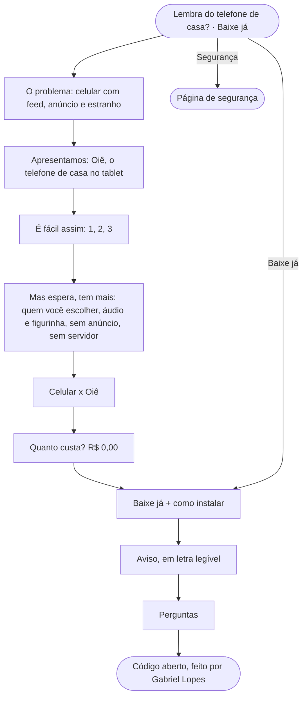

# Flow: The landing page v3 (Y2K)

_Designed with `ux-user-flows` on 2026-11-21 (owner's request). The story is from decision 0014; the look is decision 0015 (Y2K, rendered art, textures)._

- **Actor and job story:** a parent of a 9–12-year-old, often on a phone, who arrived from a link or a friend. *When I hear about Oiê, I want to get the idea in seconds and know it's safe to try, so I can put it on the family tablet.*
- **Success measure:** "Baixe já" reached in one scroll-through. The idea (the home phone, back, on the tablet) is understood from the first screen.
- **Entry points:** a shared link, search, the safety page's logo.

## Steps
| # | Scene | What the visitor sees | Action |
|---|---|---|---|
| 1 | Abertura | "Lembra do telefone de casa?" on holographic foil, and a rendered candy-plastic tablet with a handset on a curly cord; it rings twice on arrival | Baixe já (jumps to the download), Segurança |
| 2 | O problema | Today's phone, buried in old-web pop-ups (ad, buy now, a stranger, an endless feed), on dull silver. "Não precisa ser assim." | Scroll |
| 3 | Apresentamos | "Apresentamos o Oiê." in liquid chrome on a starry night: the home phone, on the tablet | Scroll |
| 4 | 1, 2, 3 | Candy lime: touch the photo; talk, write or send a sticker; it reaches the family's WhatsApp, through the parent's | Scroll |
| 5 | Tem mais | Candy tangerine, four jelly panels: who you choose, voice/photos/stickers, no ads or feed, no server | Scroll |
| 6 | Celular x Oiê | A comparison in an old desktop window, with words and ✓/✕ marks, never colour alone; on phones each row stacks | Scroll |
| 7 | Preço | "R$ 0,00" in chrome on the night; free and open source | Scroll |
| 8 | Baixe já | The download, "abra no tablet Android da criança", three install steps | Download |
| 9 | Aviso | The WhatsApp notice at body size | Read |
| 10 | Perguntas | The FAQ (open and close) | Read |
| 11 | Créditos | Open source, made by Gabriel Lopes, repo and website links, the safety page | Links |

## Branches
| At | If | Then |
|---|---|---|
| Any | "Remove animations" is on | Nothing rings or scales; every scene shows its end state. |
| 8 | The visitor isn't on an Android tablet | The note says to open the page on the kid's tablet; the install steps cover a blocked install. |
| Any | English | The EN switch swaps every line. |

## Flow review (ux-user-flows §13)
- **Happy path:** shorter than v2. There's no picker to fill in, and the download is reachable from the first screen.
- **Ethics:** no fake urgency ("só hoje"), no fake prices or testimonials, and the risk is readable.
- **Evidence:** the friend's reaction is the test. Show v3 to the same friend.
- **The look doesn't change the path** (decision 0015): the same scenes and actions as the infomercial draft, with rendered art and textures in place of the drawings.
