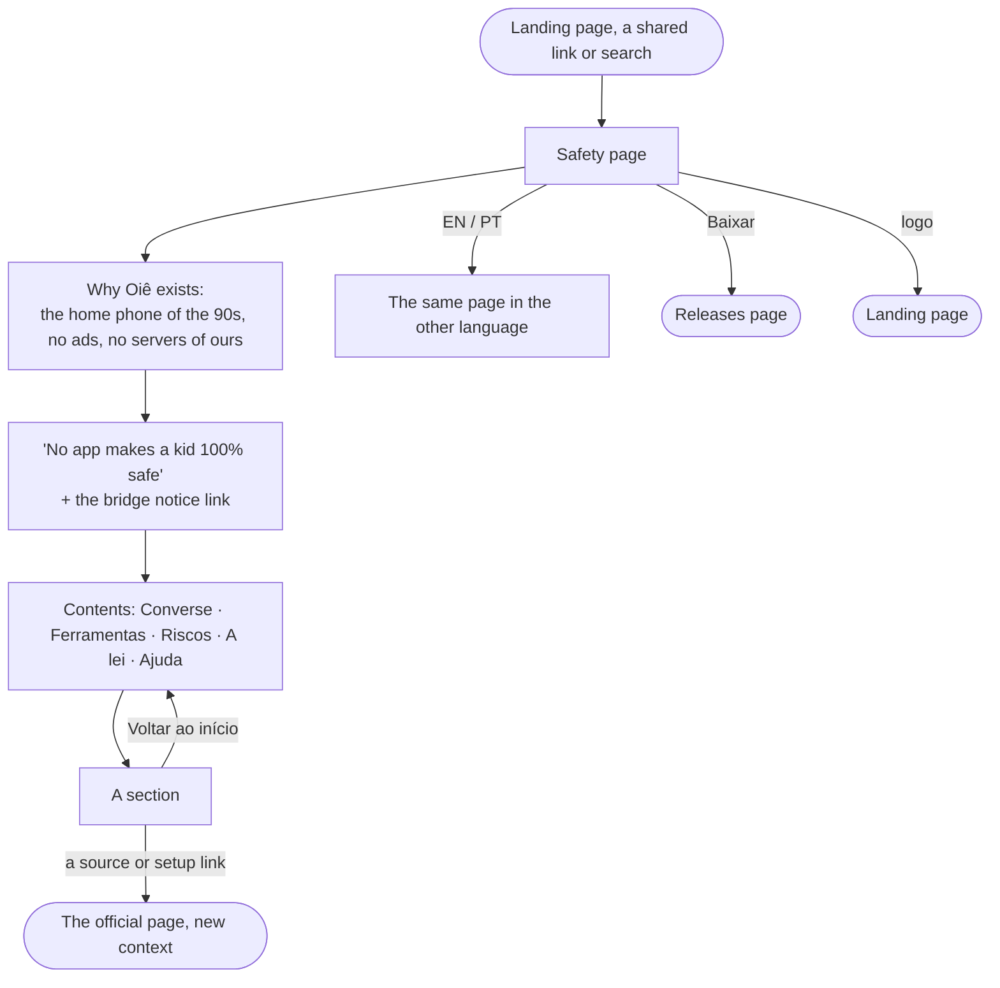

# Flow: The website's safety page (why Oiê, and a guide for parents)

_Designed with `ux-user-flows` on 2026-11-20, at the owner's request:_
- _a sub-page with a knowledge center on keeping kids safe online, the tools parents can use (Google Family Link and others), and links to the sources;_
- _at the top, why Oiê exists: kids get the reach we had with the home phone in the 90s (call a friend, meet in real life), without companies showing them ads or collecting their data._

- **Actor and job story:** a parent of a 9–12-year-old, on a phone or computer, curious or worried. *When I wonder whether my kid is ready to talk to people online, I want to know why Oiê exists and what else I can do, in plain words with sources I can trust, so I can set things up and talk with my kid.*
- **Success measure:** a parent reaches the tool they need (for example, Family Link's setup page) in two clicks from the landing page: Segurança, then the tool's link.
- **Entry points:**
  - the landing page's nav ("Segurança") and its footer;
  - a shared link (`/seguranca/`, `/safety/`);
  - search.
- **Taps on the common path:** landing page › Segurança › a section from the contents list › the source's link.

## Steps
| # | Part | What the parent does | What the page does |
|---|---|---|---|
| 1 | **Why Oiê exists** | Reads | The 90s home phone story, what Oiê is and isn't (no ads, no feed, only the people you chose, no servers of ours, no analytics or tracking), two numbers with sources. |
| 2 | **Honesty** | Reads | No app or setting makes a kid 100% safe; what works is talking, family rules and the tools already on the device. A link to the landing page's notice about using WhatsApp unofficially (product law). |
| 3 | **Contents** | Picks a section | Five anchors, each a plain question-like title. |
| 4 | **Converse primeiro** | Reads | Six tips, each with its source. |
| 5 | **Ferramentas** | Opens a tool's link | Family Link, Android and Google Play controls, Samsung Kids, Apple Screen Time, YouTube Kids, the parent's own WhatsApp settings, a family DNS. Each: what it does, its limit, "Como configurar" to the official page. |
| 6 | **Riscos** | Reads | Six risks, each: what it is, in plain words, and one thing to do. Where Oiê helps, it says so in one line, without promises. |
| 7 | **A lei no Brasil** | Reads | ECA Digital, LGPD art. 14, SBP's screen time, the federal guide on screens. |
| 8 | **Onde pedir ajuda** | Calls or opens a link | SaferNet's helpline and reporting, Disque 100, 190 in an emergency, block-report-save on the app itself. |
| 9 | **Footer** | — | Last reviewed date, "rules and menus change", not a substitute for professional advice, the legal line. |

## Branches
| At | If | Then |
|---|---|---|
| Any link out | It's an outside site | Opens normally with `rel="noopener"`; the link's text says where it goes ("Ajuda do Google"). |
| Language | The parent reads English | The EN page, same structure; links go to the English versions of sources where they exist. |
| No JavaScript | — | The page is static HTML; everything works. |
| A source moves | Its link breaks | The review date tells readers how fresh it is; the page is re-checked with each website change. |

## States
Static reading page: no loading, empty or error states. Print: the links show their address after the text.

## Exits
The landing page (logo, Baixar), the other language, any official source.

## Flow review (ux-user-flows §13)
| # | Question | Answer |
|---|---|---|
| 1 | Job | ✅ One actor (a parent), one job, a two-click measure. |
| 2 | Entries | ✅ Nav, footer, shared link, search. |
| 3 | Happy path | ✅ Contents list straight to a section. |
| 4 | Branches | ✅ Language, outside links, no JS. |
| 5 | States | ✅ Static; print shows link addresses. |
| 6 | Errors | ✅ None to make. |
| 7 | Control | ✅ The contents list and Back. |
| 8 | Progress | — A single page. |
| 9 | Memory | ✅ Each tool says what it does where it's named. |
| 10 | Exits | ✅ No dead ends. |
| 11 | Conventions | ✅ An article with a contents list. |
| 12 | Speed | ✅ No scripts needed; the shared CSS is cached from the landing page. |
| 13 | Accessibility | ✅ One h1, ordered headings, link text that says the destination, 44px targets, both themes. |
| 14 | Ethics | ✅ No fear-mongering, no "100% safe", no endorsement implied (WhatsApp, Google, the government). |
| 15 | Evidence | 🟡 Sources checked on 2026-11-20; menus change, so review with each release of the site. |
