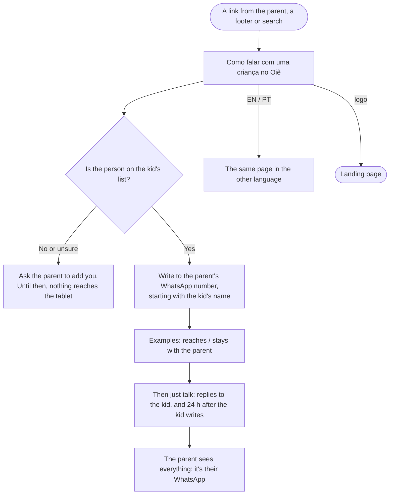

# Flow: The website's page for family and friends (how to talk to a kid on Oiê)

_Designed with `ux-user-flows` on 2026-11-21, at the owner's request: "a specific page that's not clear for users on how to start the engagement with a kid. So let's say that they want to invite my son to something, how they start it."_

- **Actor and job story:** someone on the other side, such as a grandparent, an aunt, a school friend or a friend's parent. They have WhatsApp on their phone and have never heard of Oiê. *When I want to tell the kid something (invite him to a birthday, say good night), I want to know where to write and how, so the message reaches the kid and not only the parent.*
- **Success measure:** their first message to the kid reaches the tablet. That takes one read of the page and no question to the parent.
- **Entry points:**
  - a link the parent sends ("Para falar com o Tito, veja aqui");
  - the top menu of every page ("Família e amigos", next to "Segurança"), since the owner's note of 2026-11-21: "I want this information accessible, so it should be in a top-level menu, not in the footer only";
  - the landing page's footer;
  - the safety page's footer;
  - search.
- **Preconditions:** the person is in the parent's WhatsApp contacts. They may not be on the kid's allowed list yet.
- **Context of use:** on a phone, opened from WhatsApp, read once. Some readers are older people.

## Steps (the page, top to bottom)
| # | Part | What the reader learns |
|---|---|---|
| 1 | **Title and lede** | The kid writes from the tablet, through the WhatsApp of their mum or dad. You answer as usual, on that number. |
| 2 | **1. Be on the list** | Only people the parent added reach the kid. If you aren't on the list, ask the parent. Until then, what you send stays only with the parent. |
| 3 | **2. Start with the name** | To start a conversation (an invitation, a good night), write to the parent's number and start with the kid's name: "Tito, …" or "Oi Tito, …". Two columns of examples: what reaches the tablet, and what stays with the parent ("O Tito pode vir sábado?" is to the parent). |
| 4 | **3. Then just talk** | When the kid writes to you, you can answer freely for 24 hours. A reply to one of the kid's messages always reaches the kid. If the parent answers in the middle, what follows goes to the parent until the kid writes again. |
| 5 | **The parent sees everything** | It's the parent's WhatsApp, so they see what you send to the kid. An invitation reaches both of them. |
| 6 | **Good to know** | How the kid's messages look (their emoji and name, then the message), groups (the same rule; a group the parent made for the kid gets everything), what can be sent (text, voice, photo, video, sticker; not documents, locations or polls), and quiet hours (messages wait in silence). |

## Branches
| At | If | Then |
|---|---|---|
| 2 | The reader doesn't know whether they're on the list | They ask the parent. The page never promises a message got through. |
| 3 | They wrote without the name | It stays with the parent, who can pass it on. They can write again starting with the name. |
| 6 | A group | The same rule: start with the name, or reply to the kid. |
| Any | The reader reads English | The EN page, same structure, examples in English. |
| Any | No JavaScript | Static HTML. Everything works. |

## States
Static reading page: no loading, empty or error states.

## Exits
The landing page (logo, Baixar), the other language, the safety page.

## Notes
- **Names:** Tito is the example, as on the landing page. The page calls the parent "o pai ou a mãe" and the kid "a criança", so any family can share it.
- **Honesty:** it says plainly that the parent sees everything, and never calls the kid's chat private from the parent.
- **No meeting-up wording** (the owner's note of 2026-11-21). An invitation is the example the owner gave, and it goes through the parent, who sees it.
- **Source of truth:** `MessageRule.kt` (name first after at most one greeting, reply, the 24 h window, talk about the kid, the parent taking over, kid-only chats) and `NameLine.kt`. If the rule changes, this page changes too.

## Flow review (ux-user-flows §13)
| # | Question | Answer |
|---|---|---|
| 1 | Job | ✅ One actor (family or friend), one job, a measure: the first message reaches the tablet. |
| 2 | Entries | ✅ A link from the parent, the footers, search. |
| 3 | Happy path | ✅ Three numbered things, in the order they happen. |
| 4 | Branches | ✅ Not on the list, no name, groups, the parent answering. |
| 5 | States | ✅ Static. |
| 6 | Errors | ✅ "It stayed with the parent; write again starting with the name." |
| 7 | Control | ✅ Logo, language, footer links. |
| 8 | Progress | — One page. |
| 9 | Memory | ✅ The examples sit next to the rule. |
| 10 | Exits | ✅ No dead ends. |
| 11 | Conventions | ✅ The safety page's reading layout. |
| 12 | Speed | ✅ Static, no script. |
| 13 | Accessibility | ✅ Headings in order. The examples are marked by words ("Chega", "Fica com o pai ou a mãe"), never by colour alone. |
| 14 | Ethics | ✅ It says the parent sees everything. No promise of safety. |
| 15 | Evidence | 🟡 Ask one grandparent to read it and send a first message. |

## v2 (2026-11-21): fewer words, shown with sample chats
_The owner: "the idea is to be something that parents would share with contacts or groups … very, very user-friendly and very educative, avoid a lot of wording, just clear messages … how do people in a group contact the kid and not the parent."_

The page is now five numbered steps. Each has one short rule, one line of explanation, and a sample chat whose messages say where they go in a word ("Chega na criança", "Fica com os pais", "A criança vê"):
1. Escreva no WhatsApp do pai ou da mãe (how the child's messages arrive).
2. Comece com o nome (two that reach the child, one that stays with the parents).
3. Ou responda o que ela mandou (24 hours, no name needed).
4. Em grupo, todos veem tudo (v0.46). To talk only to the parents, message them privately.
5. Os pais veem tudo.

"Bom saber" closes with three lines (the list, what can be sent, quiet hours). It replaces the long list.

- **Accessibility:** each sample message starts with a hidden "Você:" or "Tito:" for screen readers, and the tags are words.
- **The examples are checked by `MessageRuleTest.theWebsitesExamplesHold`.**
